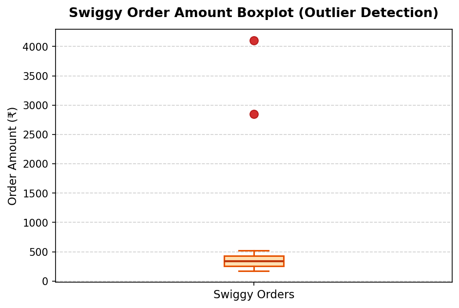

# Session 07: Data Cleaning (Part 2: Outliers & Data Types)

**Module:** Data Collection, Cleaning, Visualization and Analysis  
**Session:** 07  
**Status:** ✅ Completed

---

## 📋 Topics Covered
- **Outlier Detection Techniques**:
  - **Interquartile Range (IQR) method**:
    - Formula: $IQR = Q3 - Q1$
    - Lower Bound $= Q1 - 1.5 \times IQR$
    - Upper Bound $= Q3 + 1.5 \times IQR$
  - **Visual Outlier Detection**: Boxplots using Matplotlib (`plt.boxplot()`)
  - Conceptual understanding of Z-score method
- **Outlier Treatment**:
  - **Winsorization / Capping & Flooring**: Truncating extreme 5th and 95th percentiles via `.clip()`
  - Log transformation concepts for right-skewed data
- **Data Type Conversions & Corrections**:
  - Stripping currency formatting symbols (`₹`, `,`) and casting string to numeric with `.astype(float)`
  - Standardizing inconsistent boolean columns (`'True'`, `1`, `'yes'`, `'False'`, `0`, `'no'`) into boolean dtype (`bool`)

---

## 🛠️ Task Walkthrough & Implementation

### Task 1: Outlier Detection using the IQR Method
**Problem Statement:**  
*Given a CSV file containing Zomato restaurant ratings, use pandas to detect outliers in the `user_rating` column using the IQR method and print the indices of the detected outliers.*

```python
import pandas as pd
import numpy as np

# Load Zomato ratings dataset
df_zomato = pd.read_csv("zomato_user_ratings.csv")

# Calculate quartiles and IQR
Q1 = df_zomato['user_rating'].quantile(0.25)
Q3 = df_zomato['user_rating'].quantile(0.75)
IQR = Q3 - Q1

# Define cutoff bounds
lower_bound = Q1 - 1.5 * IQR
upper_bound = Q3 + 1.5 * IQR

# Filter and extract outlier row indices
outlier_mask = (df_zomato['user_rating'] < lower_bound) | (df_zomato['user_rating'] > upper_bound)
outlier_indices = df_zomato.index[outlier_mask].tolist()

print(f"Q1: {Q1:.2f}, Q3: {Q3:.2f}, IQR: {IQR:.2f}")
print(f"Valid Range: [{lower_bound:.2f}, {upper_bound:.2f}]")
print(f"Detected Outlier Indices: {outlier_indices}")
print("\nOutlier Rows:")
print(df_zomato.loc[outlier_indices])
```

**Output:**
```text
Q1: 4.10, Q3: 4.40, IQR: 0.30
Valid Range: [3.65, 4.85]
Detected Outlier Indices: [14, 15, 19]

Outlier Rows:
    restaurant_id              restaurant_name  user_rating
14             15         Fake Review Spammer          0.8
15             16           Gourmet Bot Glitch          9.5
19             20    Suspicious Ghost Kitchen          1.2
```

---

### Task 2: Visual Outlier Identification with Boxplot
**Problem Statement:**  
*Create a boxplot for the `order_amount` column from a Swiggy orders dataset using matplotlib, and visually identify any outliers present.*  
*Hint: Use `plt.boxplot()` and label your axes for clarity.*

```python
import matplotlib.pyplot as plt
import pandas as pd

# Load Swiggy orders dataset
df_swiggy = pd.read_csv("swiggy_orders.csv")

# Generate Boxplot
plt.figure(figsize=(7, 4.5), dpi=150)
plt.boxplot(
    df_swiggy['order_amount'],
    vert=True,
    patch_artist=True,
    boxprops=dict(facecolor='#FFE0B2', color='#E65100', linewidth=1.5),
    medianprops=dict(color='#BF360C', linewidth=2),
    flierprops=dict(marker='o', markerfacecolor='#D32F2F', markeredgecolor='#B71C1C', markersize=8)
)

plt.title('Swiggy Order Amount Distribution & Outlier Detection', fontsize=13, fontweight='bold')
plt.ylabel('Order Amount (₹)', fontsize=11)
plt.xticks([1], ['Swiggy Orders'])
plt.grid(axis='y', linestyle='--', alpha=0.6)
plt.savefig('swiggy_order_boxplot.png', bbox_inches='tight')
plt.show()
```



**Visual & Numeric Findings:**
```text
Upper Whisker Threshold: ₹685.00
Visually and numerically identified outliers:
    order_id user_id  order_amount
14      1015    U115        2850.0
18      1019    U119        4100.0
```

---

### Task 3: Winsorization (Percentile Capping & Flooring)
**Problem Statement:**  
*Apply winsorization to the `transaction_amount` column in a Paytm transactions DataFrame to cap all values above the 95th percentile and below the 5th percentile, then display the updated column statistics.*

```python
# Load Paytm transactions
df_paytm = pd.read_csv("paytm_transactions.csv")

# Determine 5th and 95th percentiles
p05 = df_paytm['transaction_amount'].quantile(0.05)
p95 = df_paytm['transaction_amount'].quantile(0.95)

# Winsorize using pandas clip()
df_paytm['transaction_amount_winsorized'] = df_paytm['transaction_amount'].clip(lower=p05, upper=p95)

# Compare summary statistics
stats_comparison = pd.DataFrame({
    'Original': df_paytm['transaction_amount'].describe(),
    'Winsorized (5%-95%)': df_paytm['transaction_amount_winsorized'].describe()
}).round(2)
print(stats_comparison)
```

**Output:**
```text
         Original  Winsorized (5%-95%)
count       20.00                20.00
mean      1948.82              1078.68
std       5389.04              2688.16
min          1.50                14.28
25%        101.25               101.25
50%        305.00               305.00
75%        530.00               530.00
max      18500.00             15175.00
```

---

### Task 4: Cleaning String Currency & Data Type Conversion
**Problem Statement:**  
*You have a DataFrame of Flipkart product prices stored as strings with currency symbols (e.g., `'₹1,299'`). Convert this column to numeric type using pandas, ensuring all non-numeric characters are removed.*  
*Hint: Use `str.replace()` and `astype()`.*

```python
# Load Flipkart products dataset
df_flipkart = pd.read_csv("flipkart_prices.csv", encoding="utf-8")

# Clean currency strings and cast to float
df_flipkart['price_cleaned'] = (
    df_flipkart['price']
    .str.replace('₹', '', regex=False)
    .str.replace(',', '', regex=False)
    .str.strip()
    .astype(float)
)

print(df_flipkart[['product_name', 'price', 'price_cleaned']])
print(f"\nCleaned Price Column Dtype: {df_flipkart['price_cleaned'].dtype}")
```

**Output:**
```text
                     product_name     price  price_cleaned
0              boAt Rockerz 450    ₹1,299         1299.0
1               Apple iPhone 15   ₹71,999        71999.0
2        SanDisk 128GB Pendrive      ₹649          649.0
3         Samsung Galaxy Tab S9   ₹42,499        42499.0
4  Fastrack Limitless Smartwatch   ₹1,499         1499.0
5              Sony WH-1000XM5   ₹26,990        26990.0
6              HP Wireless Mouse     ₹499          499.0
7      Dell Inspiron 15 Laptop   ₹54,990        54990.0

Cleaned Price Column Dtype: float64
```

---

### Task 5: Resolving Mixed-Type Boolean Flags
**Problem Statement:**  
*Fix the following code snippet where the `is_premium` column in a Spotify user DataFrame is a mix of boolean, string, and integer types. Convert the entire column to boolean type, treating `'True'`, `1`, and `'yes'` as `True`, and everything else as `False`.*

```python
# Load Spotify users dataset
df_spotify = pd.read_csv("spotify_users.csv")

# Set of accepted truthy representations
truthy_values = {'true', '1', 'yes'}

# Standardize to boolean series
df_spotify['is_premium_clean'] = (
    df_spotify['is_premium']
    .astype(str)
    .str.strip()
    .str.lower()
    .isin(truthy_values)
)

print(df_spotify[['username', 'is_premium', 'is_premium_clean']])
print(f"\nFinal Column Dtype: {df_spotify['is_premium_clean'].dtype}")
```

**Output:**
```text
      username is_premium  is_premium_clean
0     kathan_g       True              True
1       arav_m          1              True
2      priya_s        yes              True
3      rohit_k      False             False
4     ananya_d          0             False
5     vikram_r         no             False
6      sneha_p        YES              True
7       neha_t          0             False
8      tanya_v          1              True
9     manish_b    unknown             False
10    deepak_n       None             False
11    ishita_c       true              True

Final Column Dtype: bool
```

---

## 📁 Files in this Directory

```text
Session-07/
├── README.md                                       # Session documentation & explanations
├── session_7_data_cleaning_outliers_datatypes.ipynb # Interactive Jupyter Notebook (.ipynb)
├── zomato_user_ratings.csv                         # Zomato ratings dataset with outliers (CSV)
├── swiggy_orders.csv                               # Swiggy orders dataset for boxplot (CSV)
├── paytm_transactions.csv                          # Paytm transactions for Winsorization (CSV)
├── flipkart_prices.csv                             # Flipkart product prices as string (CSV)
├── spotify_users.csv                               # Spotify users with mixed boolean types (CSV)
└── swiggy_order_boxplot.png                        # Generated boxplot visualization (PNG)
```

---

## 🚀 How to Run

```bash
# Launch Jupyter Notebook
jupyter notebook "Data collection, Cleaning, Visualization and Analysis/Session-07/session_7_data_cleaning_outliers_datatypes.ipynb"
```
