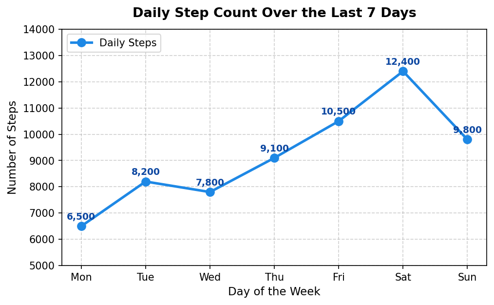
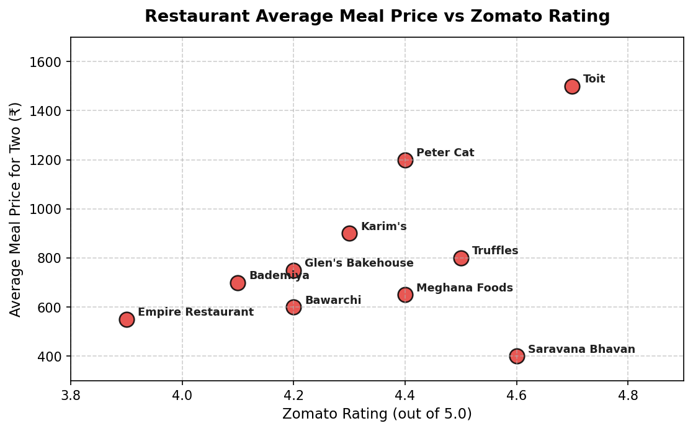
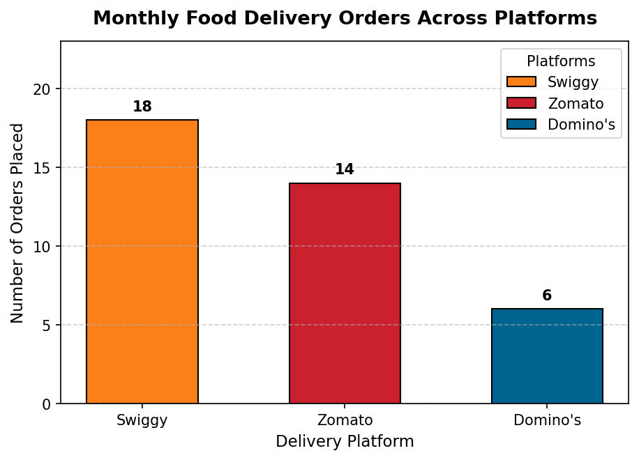
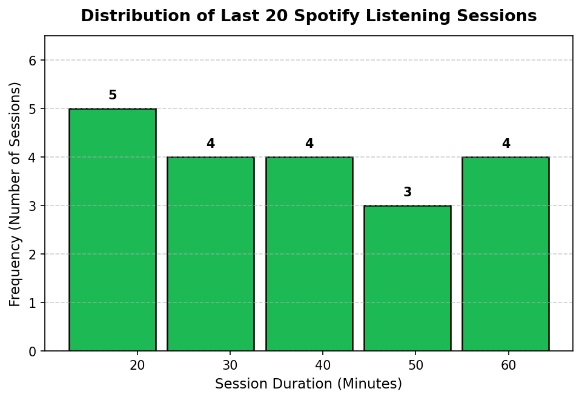
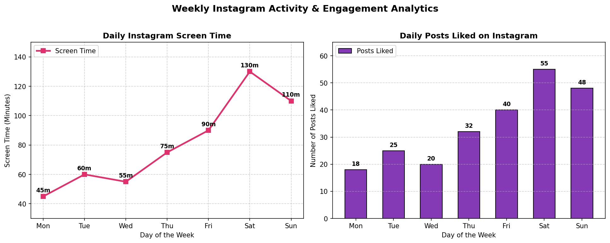

# Session 10: Data Visualization - Matplotlib (Part 1)

**Module:** Data Collection, Cleaning, Visualization and Analysis  
**Session:** 10  
**Status:** ✅ Completed

---

## 📋 Topics Covered
- **Introduction to Matplotlib**:
  - Matplotlib architecture, Figure canvas vs. Axes objects
  - Object-oriented API (`fig, ax = plt.subplots()`) vs state-based interface (`plt.plot()`)
- **Core Plot Types**:
  - **Line Plot**: Trend analysis, line styling (`linewidth`, `marker`, `linestyle`, `color`)
  - **Scatter Plot**: Bivariate relationship analysis, marker sizing, alpha transparency, text annotations
  - **Bar Chart**: Categorical metrics, individual bar coloring, data labels, legends
  - **Histogram**: Frequency distributions, continuous data binning (`bins=5`), edgecolor customization
- **Customization & High-Resolution Exports**:
  - Titles, axis labels, legends, tick styling, and grid lines
  - Multi-panel visual dashboards using `plt.subplots(1, 2)`
  - Saving charts with `plt.savefig(..., dpi=150, bbox_inches='tight')`

---

## 🛠️ Task Walkthrough & Implementation

### Task 1: Daily Step Count Line Plot (`steps_lineplot.png`)
**Problem Statement:**  
*Install Matplotlib in your Python environment and create a simple line plot showing the number of daily steps you took over the last 7 days. Save the chart as `steps_lineplot.png`.*

```python
import matplotlib.pyplot as plt
import pandas as pd

# Load daily steps data
df_steps = pd.read_csv("daily_steps.csv")

# Create Line Plot
plt.figure(figsize=(7.5, 4.2), dpi=150)
plt.plot(
    df_steps['day'],
    df_steps['steps_count'],
    marker='o',
    color='#1E88E5',
    linewidth=2.5,
    markersize=8,
    label='Daily Steps'
)

# Annotate daily step counts
for i, txt in enumerate(df_steps['steps_count']):
    plt.annotate(f"{txt:,}", (df_steps['day'][i], df_steps['steps_count'][i] + 250), ha='center', fontsize=9, fontweight='bold', color='#0D47A1')

plt.title('Daily Step Count Over the Last 7 Days', fontsize=13, fontweight='bold', pad=12)
plt.xlabel('Day of the Week', fontsize=11)
plt.ylabel('Number of Steps', fontsize=11)
plt.ylim(5000, 14000)
plt.grid(True, linestyle='--', alpha=0.6)
plt.legend(loc='upper left')

# Save chart to file
plt.savefig('steps_lineplot.png', bbox_inches='tight')
plt.show()
```



---

### Task 2: Restaurant Price vs Rating Scatter Plot
**Problem Statement:**  
*Using Matplotlib, create a scatter plot of 10 restaurants from your city with their Zomato ratings on the x-axis and average meal price on the y-axis. Add axis labels and a title to the chart.*

```python
# Load restaurant ratings & meal prices
df_zomato = pd.read_csv("zomato_restaurants.csv")

# Create Scatter Plot
plt.figure(figsize=(8.5, 4.8), dpi=150)
plt.scatter(
    df_zomato['rating'],
    df_zomato['avg_meal_price'],
    color='#E53935',
    s=130,
    alpha=0.85,
    edgecolors='black',
    linewidth=1.2,
    label='Restaurants'
)

# Annotate each restaurant name
for i, row in df_zomato.iterrows():
    plt.annotate(row['restaurant_name'], (row['rating'] + 0.02, row['avg_meal_price'] + 15), fontsize=8.5, fontweight='bold', color='#212121')

plt.title('Restaurant Average Meal Price vs Zomato Rating', fontsize=13, fontweight='bold', pad=12)
plt.xlabel('Zomato Rating (out of 5.0)', fontsize=11)
plt.ylabel('Average Meal Price for Two (₹)', fontsize=11)
plt.xlim(3.8, 4.9)
plt.ylim(300, 1700)
plt.grid(True, linestyle='--', alpha=0.6)

plt.savefig('restaurant_scatter.png', bbox_inches='tight')
plt.show()
```



---

### Task 3: Monthly Food Delivery Orders Bar Chart with Legend
**Problem Statement:**  
*Build a bar chart that shows the number of orders you or your friends placed on Swiggy, Zomato, and Domino's in the last month. Use different colors for each bar and add a legend.*

```python
# Load delivery orders
df_orders = pd.read_csv("food_delivery_orders.csv")

# Generate Bar Chart with Custom Brand Colors
plt.figure(figsize=(7, 4.5), dpi=150)
bars = plt.bar(
    df_orders['platform'],
    df_orders['orders_count'],
    color=df_orders['color'],
    width=0.55,
    edgecolor='black',
    linewidth=1
)

# Add Legend and Value Annotations
for bar, label in zip(bars, df_orders['platform']):
    bar.set_label(label)
    yval = bar.get_height()
    plt.text(bar.get_x() + bar.get_width()/2.0, yval + 0.4, int(yval), ha='center', va='bottom', fontweight='bold', fontsize=10)

plt.title('Monthly Food Delivery Orders Across Platforms', fontsize=13, fontweight='bold', pad=12)
plt.xlabel('Delivery Platform', fontsize=11)
plt.ylabel('Number of Orders Placed', fontsize=11)
plt.ylim(0, max(df_orders['orders_count']) + 5)
plt.grid(axis='y', linestyle='--', alpha=0.6)
plt.legend(title='Platforms', loc='upper right')

plt.savefig('food_delivery_barchart.png', bbox_inches='tight')
plt.show()
```



---

### Task 4: Spotify Session Duration Histogram (5 Bins)
**Problem Statement:**  
*Create a histogram of the durations (in minutes) of your last 20 Spotify listening sessions using Matplotlib. Set the number of bins to 5 and customize the color of the bars.*

```python
# Load Spotify session durations
df_spotify = pd.read_csv("spotify_sessions.csv")

# Create Histogram with 5 bins
plt.figure(figsize=(7.5, 4.5), dpi=150)
n, bins, patches = plt.hist(
    df_spotify['duration_minutes'],
    bins=5,
    color='#1DB954',
    edgecolor='black',
    linewidth=1.2,
    rwidth=0.88
)

# Label bin frequencies
for i in range(len(n)):
    if n[i] > 0:
        bin_center = (bins[i] + bins[i+1]) / 2.0
        plt.text(bin_center, n[i] + 0.15, int(n[i]), ha='center', va='bottom', fontweight='bold', fontsize=10)

plt.title('Distribution of Last 20 Spotify Listening Sessions', fontsize=13, fontweight='bold', pad=12)
plt.xlabel('Session Duration (Minutes)', fontsize=11)
plt.ylabel('Frequency (Number of Sessions)', fontsize=11)
plt.ylim(0, max(n) + 1.5)
plt.grid(axis='y', linestyle='--', alpha=0.6)

plt.savefig('spotify_session_histogram.png', bbox_inches='tight')
plt.show()
```



---

### Task 5: Multi-Plot Dashboard with Subplots (`social_media_usage.png`)
**Problem Statement:**  
*Customize a Matplotlib figure by creating a plot with two subplots: one line plot showing your daily Instagram screen time for a week, and one bar chart showing the number of posts you liked each day. Add appropriate titles, axis labels, and save the figure as `social_media_usage.png`.*  
*Hint: Use `plt.subplots()` to create multiple axes in one figure.*

```python
# Load weekly Instagram usage data
df_insta = pd.read_csv("instagram_usage.csv")

# Create 1x2 Subplot Canvas
fig, (ax1, ax2) = plt.subplots(1, 2, figsize=(13, 5), dpi=150)

# Subplot 1: Line plot for screen time
ax1.plot(
    df_insta['day'],
    df_insta['screen_time_mins'],
    marker='s',
    color='#E1306C',
    linewidth=2.5,
    markersize=7,
    label='Screen Time'
)
for i, txt in enumerate(df_insta['screen_time_mins']):
    ax1.annotate(f"{txt}m", (df_insta['day'][i], df_insta['screen_time_mins'][i] + 3), ha='center', fontsize=9, fontweight='bold')
ax1.set_title('Daily Instagram Screen Time', fontsize=12, fontweight='bold')
ax1.set_xlabel('Day of the Week', fontsize=10)
ax1.set_ylabel('Screen Time (Minutes)', fontsize=10)
ax1.set_ylim(30, 150)
ax1.grid(True, linestyle='--', alpha=0.6)
ax1.legend(loc='upper left')

# Subplot 2: Bar chart for posts liked
bars = ax2.bar(df_insta['day'], df_insta['posts_liked'], color='#833AB4', edgecolor='black', width=0.58, label='Posts Liked')
for bar in bars:
    yval = bar.get_height()
    ax2.text(bar.get_x() + bar.get_width()/2.0, yval + 1, int(yval), ha='center', va='bottom', fontweight='bold', fontsize=9)
ax2.set_title('Daily Posts Liked on Instagram', fontsize=12, fontweight='bold')
ax2.set_xlabel('Day of the Week', fontsize=10)
ax2.set_ylabel('Number of Posts Liked', fontsize=10)
ax2.set_ylim(0, max(df_insta['posts_liked']) + 10)
ax2.grid(axis='y', linestyle='--', alpha=0.6)
ax2.legend(loc='upper left')

fig.suptitle('Weekly Instagram Activity & Engagement Analytics', fontsize=14, fontweight='bold', y=1.02)
fig.tight_layout()

# Save dashboard figure
fig.savefig('social_media_usage.png', bbox_inches='tight')
plt.show()
```



---

## 📁 Files in this Directory

```text
Session-10/
├── README.md                                           # Session documentation & explanations
├── session_10_matplotlib_visualization_part1.ipynb      # Interactive Jupyter Notebook (.ipynb)
├── daily_steps.csv                                     # 7-day step counts dataset (CSV)
├── zomato_restaurants.csv                              # Restaurant ratings and meal prices (CSV)
├── food_delivery_orders.csv                            # Monthly order volume per platform (CSV)
├── spotify_sessions.csv                                # 20 Spotify session duration records (CSV)
├── instagram_usage.csv                                 # Weekly screen time and engagement records (CSV)
├── steps_lineplot.png                                  # Exported daily steps line chart (PNG)
├── restaurant_scatter.png                              # Exported restaurant scatter plot (PNG)
├── food_delivery_barchart.png                          # Exported platform delivery bar chart (PNG)
├── spotify_session_histogram.png                       # Exported session duration histogram (PNG)
└── social_media_usage.png                              # Exported multi-subplot dashboard (PNG)
```

---

## 🚀 How to Run

```bash
# Launch Jupyter Notebook
jupyter notebook "Data collection, Cleaning, Visualization and Analysis/Session-10/session_10_matplotlib_visualization_part1.ipynb"
```
