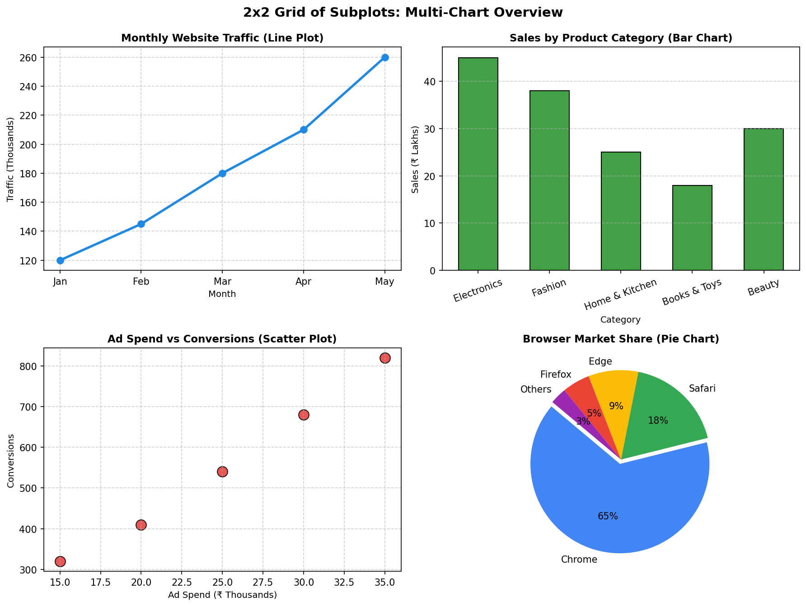
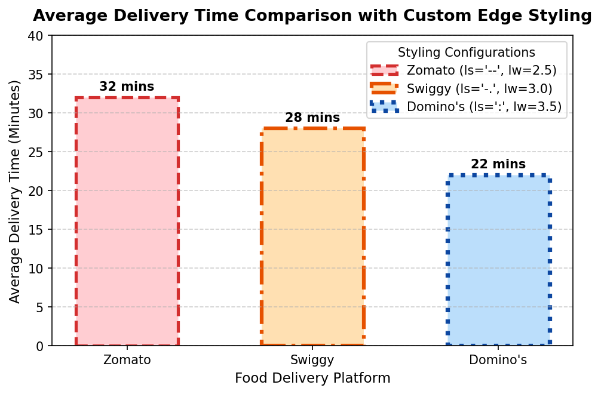
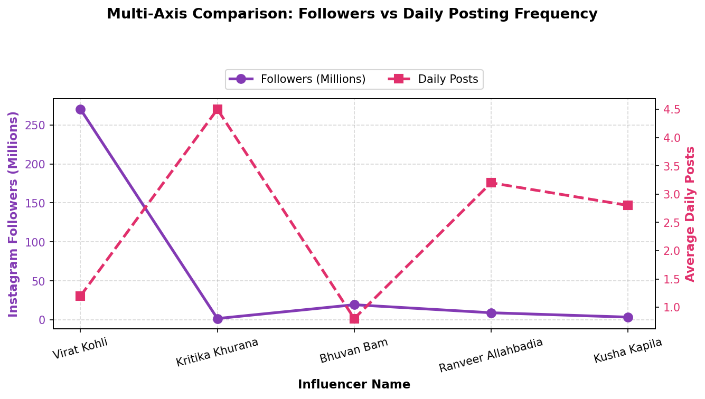
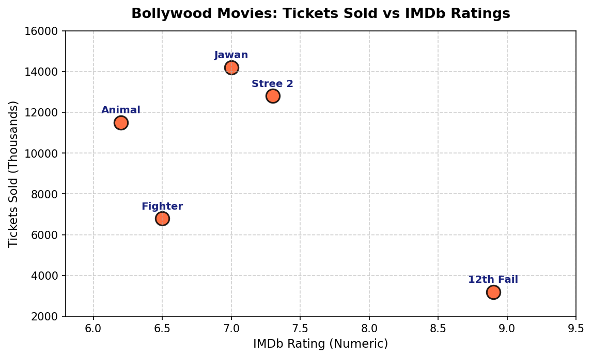
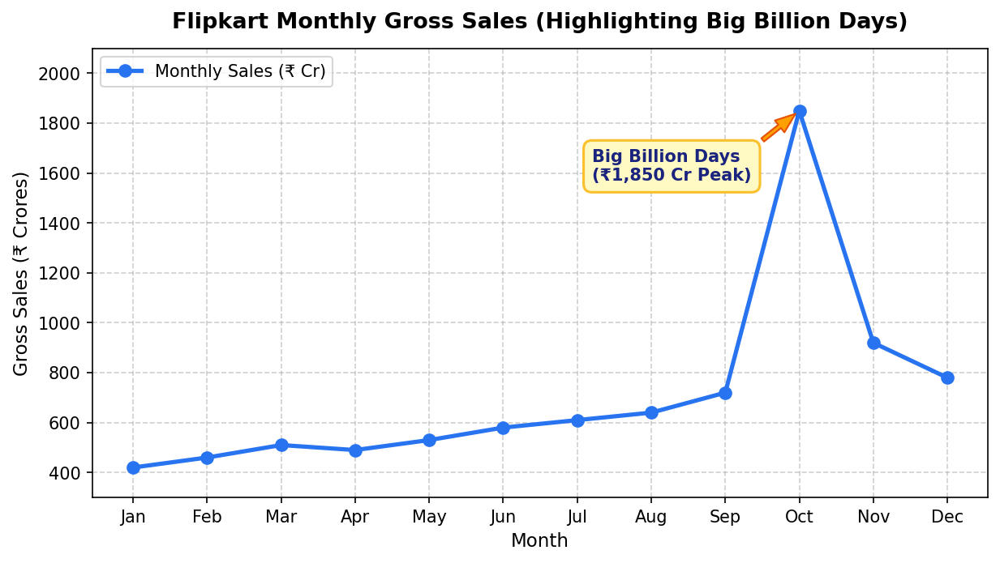

# Session 11: Data Visualization - Matplotlib (Part 2)

**Module:** Data Collection, Cleaning, Visualization and Analysis  
**Session:** 11  
**Status:** ✅ Completed

---

## 📋 Topics Covered
- **Subplots & Multi-Panel Grids**:
  - `plt.subplots(2, 2)` for multi-chart dashboard architectures (Line, Bar, Scatter, Pie)
- **Advanced Plot Styling**:
  - Controlling `linestyle` (`'--'`, `'-.'`, `':'`), `linewidth`, and edge color contrasts
- **Multi-Axis Visualizations (`ax.twinx()`)**:
  - Plotting metrics with disparate numerical orders of magnitude (Followers in Millions vs. Daily Posts)
  - Synchronizing twin-axis legends and colored tick parameters
- **Categorical vs. Numeric Scatter Plots**:
  - Mapping entity categories alongside continuous metrics with dynamic text labels
- **Storytelling Annotations & Callouts**:
  - Directional vector arrows and bounding callout boxes via `ax.annotate()`

---

## 🛠️ Task Walkthrough & Implementation

### Task 1: 2x2 Grid of Subplots (Line, Bar, Scatter, Pie)
**Problem Statement:**  
*Use `plt.subplots()` to create a 2x2 grid of subplots and plot four different types of charts (line, bar, scatter, and pie) using any sample data of your choice.*

```python
import matplotlib.pyplot as plt
import pandas as pd

# Load sample dataset
df_sample = pd.read_csv("four_charts_sample.csv")

# Initialize 2x2 grid
fig, axs = plt.subplots(2, 2, figsize=(12, 9), dpi=150)

# (0, 0) Line plot
axs[0, 0].plot(df_sample['month'], df_sample['web_traffic_thousands'], marker='o', color='#1E88E5', linewidth=2.5, markersize=7)
axs[0, 0].set_title('Monthly Website Traffic (Line Plot)', fontsize=11, fontweight='bold')
axs[0, 0].set_xlabel('Month', fontsize=9.5)
axs[0, 0].set_ylabel('Traffic (Thousands)', fontsize=9.5)
axs[0, 0].grid(True, linestyle='--', alpha=0.6)

# (0, 1) Bar chart
axs[0, 1].bar(df_sample['product_category'], df_sample['category_sales_lakhs'], color='#43A047', edgecolor='black', width=0.55)
axs[0, 1].set_title('Sales by Product Category (Bar Chart)', fontsize=11, fontweight='bold')
axs[0, 1].set_xlabel('Category', fontsize=9.5)
axs[0, 1].set_ylabel('Sales (₹ Lakhs)', fontsize=9.5)
axs[0, 1].tick_params(axis='x', rotation=20)
axs[0, 1].grid(axis='y', linestyle='--', alpha=0.6)

# (1, 0) Scatter plot
axs[1, 0].scatter(df_sample['ad_spend_thousands'], df_sample['conversions'], color='#E53935', s=120, edgecolor='black', alpha=0.85)
axs[1, 0].set_title('Ad Spend vs Conversions (Scatter Plot)', fontsize=11, fontweight='bold')
axs[1, 0].set_xlabel('Ad Spend (₹ Thousands)', fontsize=9.5)
axs[1, 0].set_ylabel('Conversions', fontsize=9.5)
axs[1, 0].grid(True, linestyle='--', alpha=0.6)

# (1, 1) Pie chart
pie_colors = ['#4285F4', '#34A853', '#FBBC05', '#EA4335', '#9C27B0']
axs[1, 1].pie(df_sample['browser_market_share'], labels=df_sample['browser'], autopct='%1.0f%%', startangle=140, colors=pie_colors, explode=(0.05, 0, 0, 0, 0))
axs[1, 1].set_title('Browser Market Share (Pie Chart)', fontsize=11, fontweight='bold')

fig.suptitle('2x2 Grid of Subplots: Multi-Chart Overview', fontsize=14, fontweight='bold', y=0.99)
fig.tight_layout()
plt.savefig('grid_2x2_charts.png', bbox_inches='tight')
plt.show()
```



---

### Task 2: Delivery Time Bar Chart with Custom Linestyles & Linewidths
**Problem Statement:**  
*Plot a comparison of average delivery times for Zomato, Swiggy, and Domino's using a bar chart, and style each bar with a different color, linestyle, and linewidth using Matplotlib plot styling options.*

```python
# Load delivery times data
df_delivery = pd.read_csv("delivery_times.csv")

fig, ax = plt.subplots(figsize=(7.5, 4.5), dpi=150)
bars = ax.bar(
    df_delivery['platform'],
    df_delivery['avg_delivery_time_mins'],
    color=df_delivery['color'],
    edgecolor=df_delivery['edge_color'],
    width=0.55
)

# Apply individual linestyles, linewidths, and labels
for bar, row in zip(bars, df_delivery.itertuples()):
    bar.set_linestyle(row.linestyle)
    bar.set_linewidth(row.linewidth)
    bar.set_label(f"{row.platform} (ls='{row.linestyle}', lw={row.linewidth})")
    yval = bar.get_height()
    ax.text(bar.get_x() + bar.get_width()/2.0, yval + 0.6, f"{int(yval)} mins", ha='center', va='bottom', fontweight='bold', fontsize=10)

ax.set_title('Average Delivery Time Comparison with Custom Edge Styling', fontsize=13, fontweight='bold', pad=12)
ax.set_xlabel('Food Delivery Platform', fontsize=11)
ax.set_ylabel('Average Delivery Time (Minutes)', fontsize=11)
ax.set_ylim(0, 40)
ax.grid(axis='y', linestyle='--', alpha=0.6)
ax.legend(title='Styling Configurations', loc='upper right')

plt.savefig('delivery_time_comparison.png', bbox_inches='tight')
plt.show()
```



---

### Task 3: Multi-Axis Chart (Instagram Followers vs. Daily Posts)
**Problem Statement:**  
*Create a multi-axis chart that shows the number of Instagram followers (left y-axis) and average daily posts (right y-axis) for five influencers. Use different colors and markers for each axis.*

```python
# Load influencer metrics
df_influencers = pd.read_csv("influencers_metrics.csv")

fig, ax1 = plt.subplots(figsize=(9, 4.8), dpi=150)

# Left Axis: Followers
color1 = '#833AB4'
ax1.set_xlabel('Influencer Name', fontsize=11, fontweight='bold')
ax1.set_ylabel('Instagram Followers (Millions)', color=color1, fontsize=11, fontweight='bold')
line1 = ax1.plot(df_influencers['influencer_name'], df_influencers['followers_millions'], color=color1, marker='o', linewidth=2.5, markersize=8, label='Followers (Millions)')
ax1.tick_params(axis='y', labelcolor=color1)
ax1.tick_params(axis='x', rotation=15)
ax1.grid(True, linestyle='--', alpha=0.5)

# Right Axis (Twin): Daily Posts
ax2 = ax1.twinx()
color2 = '#E1306C'
ax2.set_ylabel('Average Daily Posts', color=color2, fontsize=11, fontweight='bold')
line2 = ax2.plot(df_influencers['influencer_name'], df_influencers['avg_daily_posts'], color=color2, marker='s', linewidth=2.5, markersize=8, linestyle='--', label='Daily Posts')
ax2.tick_params(axis='y', labelcolor=color2)

# Unified Legend
lines = line1 + line2
labels = [l.get_label() for l in lines]
ax1.legend(lines, labels, loc='upper center', bbox_to_anchor=(0.5, 1.15), ncol=2, frameon=True)

fig.suptitle('Multi-Axis Comparison: Followers vs Daily Posting Frequency', fontsize=13, fontweight='bold', y=1.04)
fig.tight_layout()
plt.savefig('influencers_dual_axis.png', bbox_inches='tight')
plt.show()
```



---

### Task 4: Categorical vs Numeric Scatter Plot with Text Annotations
**Problem Statement:**  
*Plot the number of tickets sold for five recent Bollywood movies (categorical) versus their IMDb ratings (numeric) using a scatter plot. Add annotations to display the movie names above each point.*

```python
# Load Bollywood movies data
df_movies = pd.read_csv("bollywood_movies.csv")

fig, ax = plt.subplots(figsize=(8.5, 4.8), dpi=150)
ax.scatter(df_movies['imdb_rating'], df_movies['tickets_sold_thousands'], color='#FF5722', s=160, edgecolor='black', linewidth=1.5, alpha=0.85, label='Movies')

# Add dynamic text annotations
for i, row in df_movies.iterrows():
    ax.annotate(row['movie_title'], (row['imdb_rating'], row['tickets_sold_thousands'] + 450), ha='center', fontsize=9.5, fontweight='bold', color='#1A237E')

ax.set_title('Bollywood Movies: Tickets Sold vs IMDb Ratings', fontsize=13, fontweight='bold', pad=12)
ax.set_xlabel('IMDb Rating (Numeric)', fontsize=11)
ax.set_ylabel('Tickets Sold (Thousands)', fontsize=11)
ax.set_xlim(5.8, 9.5)
ax.set_ylim(2000, 16000)
ax.grid(True, linestyle='--', alpha=0.6)

plt.savefig('bollywood_tickets_vs_rating.png', bbox_inches='tight')
plt.show()
```



---

### Task 5: Custom Callout Annotation with Arrow ('Big Billion Days')
**Problem Statement:**  
*Add a custom text annotation to a Matplotlib chart showing Flipkart's monthly sales, marking the highest sales point with the label 'Big Billion Days'.*  
*Hint: Use the `ax.annotate()` function to place the label at the correct data point.*

```python
# Load Flipkart monthly gross sales
df_sales = pd.read_csv("flipkart_monthly_sales.csv")

fig, ax = plt.subplots(figsize=(9.5, 4.8), dpi=150)
ax.plot(df_sales['month_name'], df_sales['sales_crores'], marker='o', color='#2874F0', linewidth=2.5, markersize=7, label='Monthly Sales (₹ Cr)')

# Locate October peak
oct_idx = df_sales[df_sales['month_name'] == 'Oct'].index[0]
oct_sales = df_sales.loc[oct_idx, 'sales_crores']

# Custom vector arrow annotation
ax.annotate(
    'Big Billion Days\n(₹1,850 Cr Peak)',
    xy=(oct_idx, oct_sales),
    xytext=(oct_idx - 2.8, oct_sales - 280),
    arrowprops=dict(facecolor='#FF9F00', shrink=0.08, width=2.5, headwidth=9, edgecolor='#E65100'),
    fontsize=10,
    fontweight='bold',
    color='#1A237E',
    bbox=dict(boxstyle='round,pad=0.5', facecolor='#FFF9C4', edgecolor='#FBC02D', linewidth=1.5)
)

ax.set_title('Flipkart Monthly Gross Sales (Highlighting Big Billion Days)', fontsize=13, fontweight='bold', pad=12)
ax.set_xlabel('Month', fontsize=11)
ax.set_ylabel('Gross Sales (₹ Crores)', fontsize=11)
ax.set_ylim(300, 2100)
ax.grid(True, linestyle='--', alpha=0.6)
ax.legend(loc='upper left')

plt.savefig('flipkart_sales_annotation.png', bbox_inches='tight')
plt.show()
```



---

## 📁 Files in this Directory

```text
Session-11/
├── README.md                                           # Session documentation & explanations
├── session_11_matplotlib_visualization_part2.ipynb      # Interactive Jupyter Notebook (.ipynb)
├── four_charts_sample.csv                              # Multi-metric dataset for 2x2 grid (CSV)
├── delivery_times.csv                                  # Delivery duration and styling configurations (CSV)
├── influencers_metrics.csv                             # Influencer follower and daily post metrics (CSV)
├── bollywood_movies.csv                                # Bollywood box office and ratings dataset (CSV)
├── flipkart_monthly_sales.csv                          # Monthly gross merchandise value dataset (CSV)
├── grid_2x2_charts.png                                 # Exported 2x2 grid multi-chart figure (PNG)
├── delivery_time_comparison.png                        # Exported delivery bar chart with edge styling (PNG)
├── influencers_dual_axis.png                           # Exported dual-axis comparison figure (PNG)
├── bollywood_tickets_vs_rating.png                     # Exported categorical vs numeric scatter plot (PNG)
└── flipkart_sales_annotation.png                       # Exported annotated sales trajectory figure (PNG)
```

---

## 🚀 How to Run

```bash
# Launch Jupyter Notebook
jupyter notebook "Data collection, Cleaning, Visualization and Analysis/Session-11/session_11_matplotlib_visualization_part2.ipynb"
```
