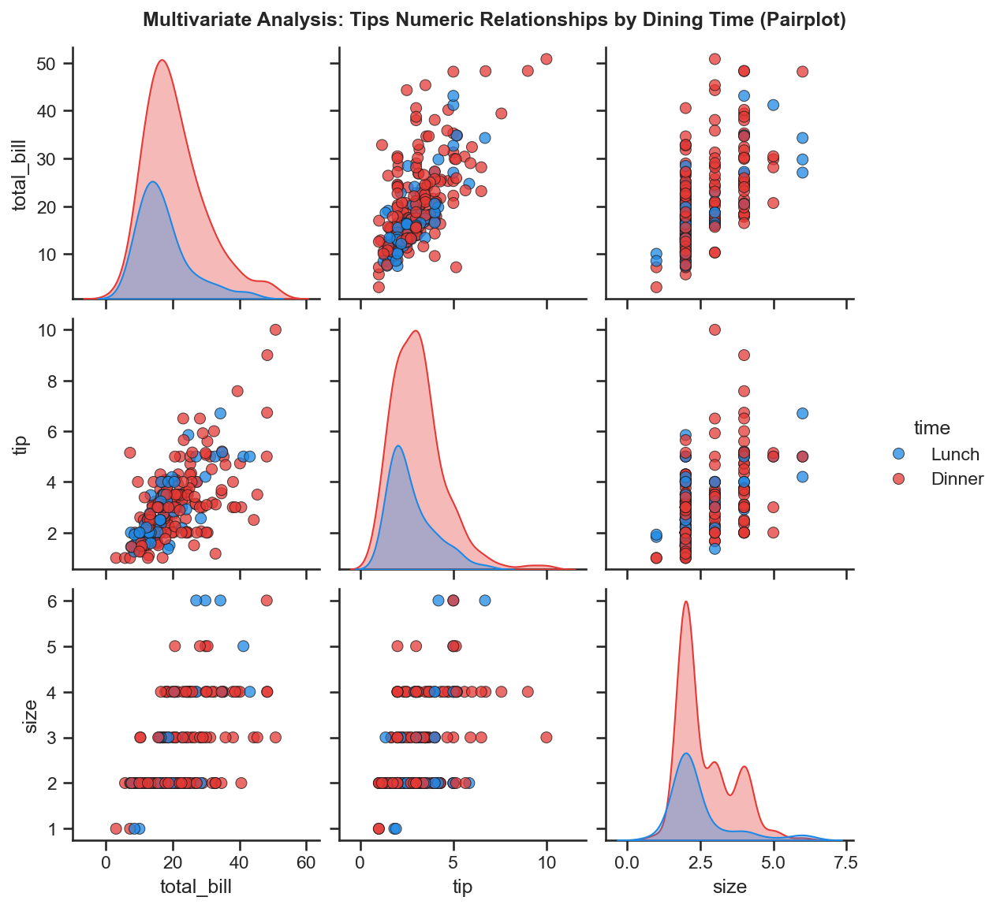
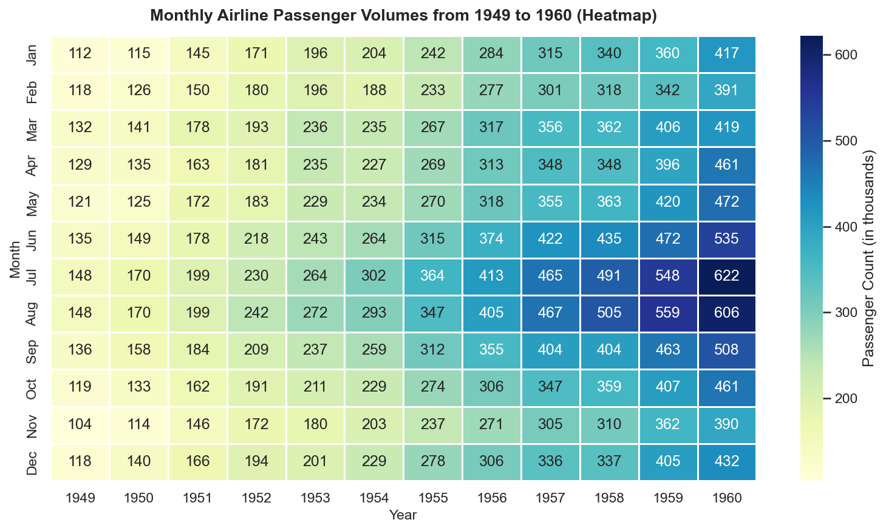
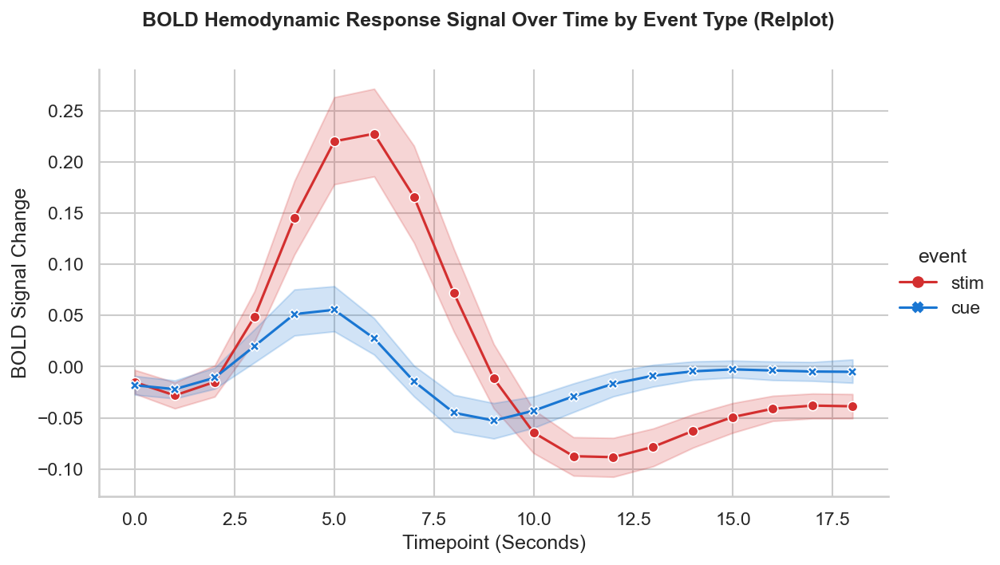
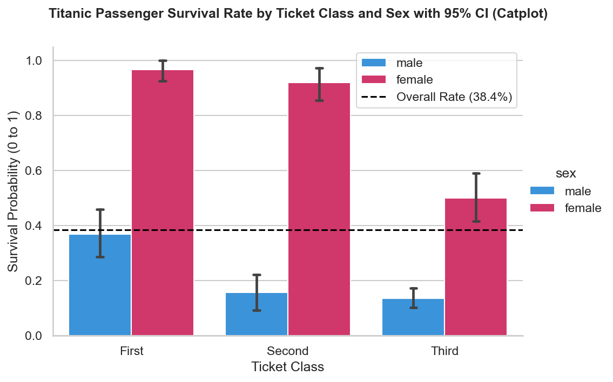
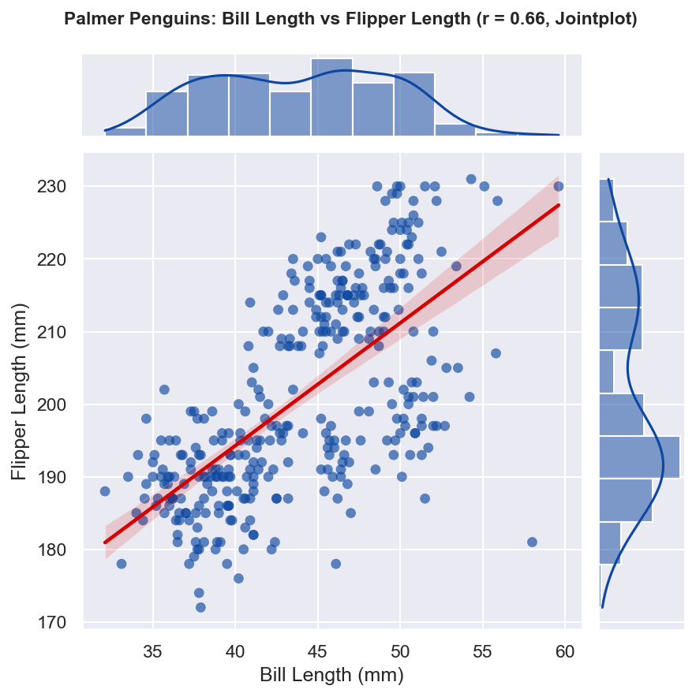

# Session 13: Data Visualization with Seaborn (Part 2)

**Module:** Data Collection, Cleaning, Visualization and Analysis  
**Session:** 13  
**Status:** ✅ Completed

---

## 🎯 Topics Covered
- **Pairplot for Quick Multivariate Analysis**:
  - `sns.pairplot()` for high-dimensional feature exploration and pairwise cross-correlations
  - Mapping categorical hues (`hue='time'`) across diagonal density plots (KDE) and bivariate scatter plots
- **Heatmaps for 2D Matrix & Correlation Analysis**:
  - Reshaping multi-index data using Pandas `pivot_table(index, columns, values)`
  - Visualizing seasonal volume intensity with `sns.heatmap()`, integer annotations (`fmt='d'`), and colormaps (`cmap='YlGnBu'`)
- **Figure-Level Relational Plotting (`sns.relplot`)**:
  - Managing multi-condition visual attributes (`hue`, `style`, `markers`) on continuous time-series trajectories
  - Automated 95% bootstrap confidence bands (`errorbar='ci'`) for BOLD signal events
- **Figure-Level Categorical Plotting (`sns.catplot`)**:
  - Estimating probability distributions across demographic cohorts with `kind='bar'`
  - Computing and displaying 95% confidence intervals and visual error caps (`capsize`)
- **Jointplot with Linear Regression Fit (`sns.jointplot`)**:
  - Blending central scatter plots with marginal univariate histograms
  - Fitting Ordinary Least Squares (OLS) regression lines via `kind='reg'` and computing Pearson correlation ($r$)

---

## 📝 Task Walkthrough & Implementation

### Task 1: Multivariate Analysis on 'tips' Dataset (Pairplot)
**Problem Statement:**  
*Load the 'tips' dataset from Seaborn and create a `pairplot` to quickly visualize relationships between all numeric variables.*

```python
import seaborn as sns
import matplotlib.pyplot as plt
import pandas as pd

# Load dataset
df_tips = sns.load_dataset("tips")

# Pairplot across all numeric features partitioned by dining time
sns.set_theme(style="ticks")
g = sns.pairplot(
    data=df_tips,
    vars=["total_bill", "tip", "size"],
    hue="time",
    palette={"Lunch": "#1E88E5", "Dinner": "#E53935"},
    diag_kind="kde",
    plot_kws={"alpha": 0.75, "s": 45, "edgecolor": "k", "linewidth": 0.5},
    diag_kws={"fill": True, "alpha": 0.35}
)

g.fig.suptitle("Multivariate Analysis: Tips Numeric Relationships by Dining Time (Pairplot)", y=1.02, fontsize=12, fontweight="bold")
plt.savefig("tips_pairplot.png", bbox_inches="tight", dpi=150)
plt.show()
```



**Key Observations:**
- A strong positive linear correlation ($r = 0.676$) exists between `total_bill` and `tip`.
- Dinner bills and party sizes skew higher than lunch orders, with dinner tips reaching up to $10.

---

### Task 2: Airline Passenger Growth & Seasonality Heatmap (Flights Dataset)
**Problem Statement:**  
*Using the 'flights' dataset from Seaborn, generate a `heatmap` showing the correlation between months and years based on the number of passengers.*  
*Hint: Use `pivot_table` to reshape the data before plotting the heatmap.*

```python
# Load flights dataset
df_flights = sns.load_dataset("flights")

# Reshape into a 2D matrix (months as rows, years as columns)
flights_pivot = df_flights.pivot_table(index="month", columns="year", values="passengers", observed=False).astype(int)

plt.figure(figsize=(10.5, 6), dpi=150)
sns.set_theme(style="white")

ax = sns.heatmap(
    flights_pivot,
    annot=True,
    fmt="d",
    cmap="YlGnBu",
    linewidths=0.5,
    cbar_kws={"label": "Passenger Count (in thousands)"}
)

plt.title("Monthly Airline Passenger Volumes from 1949 to 1960 (Heatmap)", fontsize=13, fontweight="bold", pad=12)
plt.xlabel("Year", fontsize=11)
plt.ylabel("Month", fontsize=11)
plt.tight_layout()
plt.savefig("flights_passenger_heatmap.png", bbox_inches="tight")
plt.show()
```



**Key Observations:**
- **Secular Growth**: Passenger volume expanded monotonically year-over-year from 1949 (112k peak) to 1960 (622k peak), illustrating the post-war commercial aviation boom.
- **Seasonality**: July and August consistently register the highest passenger volume across every recorded year.

---

### Task 3: BOLD Hemodynamic Response Trajectory (FMRI Relplot)
**Problem Statement:**  
*Create a `relplot` using the 'fmri' dataset from Seaborn to visualize how the signal changes over time for different event types.*

```python
# Load fmri dataset
df_fmri = sns.load_dataset("fmri")

sns.set_theme(style="whitegrid")

g = sns.relplot(
    data=df_fmri,
    x="timepoint",
    y="signal",
    hue="event",
    style="event",
    kind="line",
    errorbar="ci",
    markers=True,
    dashes=False,
    palette={"stim": "#D32F2F", "cue": "#1976D2"},
    height=4.8,
    aspect=1.6
)

g.fig.subplots_adjust(top=0.88)
g.fig.suptitle("BOLD Hemodynamic Response Signal Over Time by Event Type (Relplot)", fontsize=12, fontweight="bold")
g.set_axis_labels("Timepoint (Seconds)", "BOLD Signal Change")
plt.savefig("fmri_signal_relplot.png", bbox_inches="tight", dpi=150)
plt.show()
```



**Key Observations:**
- Stimulus activation (`'stim'`) produces a distinct positive hemodynamic response peak between 4 and 6 seconds.
- The cue condition (`'cue'`) exhibits a lower baseline activation, with shaded bands representing 95% bootstrap confidence intervals across human subjects.

---

### Task 4: Titanic Passenger Survival Rates with Confidence Intervals (Catplot)
**Problem Statement:**  
*Pick any categorical column from the 'titanic' dataset (like 'class' or 'sex') and use `catplot` to display the survival rate for each group with confidence intervals.*

```python
# Load titanic dataset
df_titanic = sns.load_dataset("titanic")

sns.set_theme(style="whitegrid")

g = sns.catplot(
    data=df_titanic,
    x="class",
    y="survived",
    hue="sex",
    kind="bar",
    order=["First", "Second", "Third"],
    palette={"female": "#E91E63", "male": "#2196F3"},
    errorbar=("ci", 95),
    capsize=0.08,
    height=4.8,
    aspect=1.4
)

g.fig.subplots_adjust(top=0.88)
g.fig.suptitle("Titanic Passenger Survival Rate by Ticket Class and Sex with 95% CI (Catplot)", fontsize=12, fontweight="bold")
g.set_axis_labels("Ticket Class", "Survival Probability (0 to 1)")
g.set(ylim=(0, 1.05))

overall_rate = df_titanic["survived"].mean()
for ax in g.axes.flat:
    ax.axhline(overall_rate, color="black", linestyle="--", linewidth=1.5, label=f"Overall Rate ({overall_rate:.1%})")
    ax.legend(loc="upper right")

plt.savefig("titanic_survival_catplot.png", bbox_inches="tight", dpi=150)
plt.show()
```



**Key Observations:**
- Female passengers in First Class exhibited a **96.8%** survival rate, compared to **13.5%** for Third Class male passengers.
- Error bars illustrate the 95% bootstrap confidence interval, showing tighter bounds for groups with higher sample sizes.

---

### Task 5: Palmer Penguins Morphometrics & OLS Regression (Jointplot)
**Problem Statement:**  
*Use `jointplot` on the 'penguins' dataset to visualize the relationship between `bill_length_mm` and `flipper_length_mm`, and fit a regression line on the scatter plot.*  
*Hint: Set `kind='reg'` in `jointplot` for regression line.*

```python
from scipy import stats

# Load penguins dataset
df_penguins = sns.load_dataset("penguins").dropna(subset=["bill_length_mm", "flipper_length_mm"])

# Pearson correlation
r_val, p_val = stats.pearsonr(df_penguins["bill_length_mm"], df_penguins["flipper_length_mm"])

sns.set_theme(style="darkgrid")

g = sns.jointplot(
    data=df_penguins,
    x="bill_length_mm",
    y="flipper_length_mm",
    kind="reg",
    color="#0D47A1",
    scatter_kws={"alpha": 0.65, "s": 38, "edgecolor": "none"},
    line_kws={"color": "#D50000", "linewidth": 2.2},
    height=6
)

g.fig.subplots_adjust(top=0.92)
g.fig.suptitle(f"Palmer Penguins: Bill Length vs Flipper Length (r = {r_val:.2f}, Jointplot)", fontsize=11, fontweight="bold")
g.set_axis_labels("Bill Length (mm)", "Flipper Length (mm)")
plt.savefig("penguins_jointplot_regression.png", bbox_inches="tight", dpi=150)
plt.show()
```



**Key Observations:**
- A strong positive linear relationship exists between flipper length and bill length ($r = 0.656$, $p < 10^{-42}$).
- Marginal density histograms show bimodal features caused by morphometric clustering across species (Gentoo vs Adelie/Chinstrap).

---

## 📁 Files in this Directory

```text
Session-13/
├── README.md                                           # Session documentation & explanations
├── session_13_seaborn_visualization_part2.ipynb        # Interactive Jupyter Notebook (.ipynb)
├── tips.csv                                            # Dining tips & bill dataset (CSV)
├── flights.csv                                         # 1949-1960 airline passengers dataset (CSV)
├── fmri.csv                                            # Human brain BOLD signal time series (CSV)
├── titanic.csv                                         # Titanic passenger demographics & survival (CSV)
├── penguins.csv                                        # Palmer Archipelago penguins morphometrics (CSV)
├── tips_pairplot.png                                   # Exported pairwise multivariate plot (PNG)
├── flights_passenger_heatmap.png                       # Exported passenger seasonality heatmap (PNG)
├── fmri_signal_relplot.png                             # Exported BOLD signal temporal trajectory (PNG)
├── titanic_survival_catplot.png                        # Exported survival rates by class/sex with CI (PNG)
└── penguins_jointplot_regression.png                   # Exported joint distribution with OLS fit (PNG)
```

---

## 🚀 How to Run

```bash
# Launch Jupyter Notebook
jupyter notebook "Data collection, Cleaning, Visualization and Analysis/Session-13/session_13_seaborn_visualization_part2.ipynb"
```
