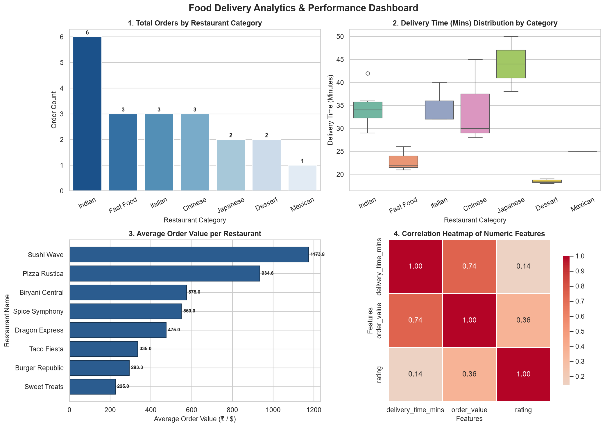

# Section B: Practical Coding Tasks — Assessment M4-A1
**Program**: Data Science  
**Module 3–4**: Data Collection, Cleaning & Visualization › Working with Databases  
**Stack**: Python 3 / SQL (SQLite)

---

## Task 1: Daily Order Analysis with NumPy

### Preferred Language & Libraries
* **Language**: Python 3
* **Library**: NumPy (`numpy`)
* **Script**: [`task1_numpy_analysis.py`](task1_numpy_analysis.py)

### Requirements Implemented
1. Generated two 30-element arrays with `np.random.seed(42)`:
   * Daily order counts (integers between 100–800)
   * Daily revenue (floats between 5,000–50,000)
2. Calculated: total orders, total revenue, mean daily orders, standard deviation, and day index with highest revenue.
3. Boolean indexing: extracted all days where `order_count > mean + 1 * std_dev`, reporting count and total revenue.
4. Reshaping: converted 30-element order array into a $5 \times 6$ matrix and computed weekly block totals using `np.sum(axis=1)`.

### Code Implementation
```python
import numpy as np

# 1. Set seed for reproducibility
np.random.seed(42)
daily_orders = np.random.randint(100, 801, size=30)
daily_revenue = np.random.uniform(5000, 50000, size=30).round(2)

# 2. Key Statistical Metrics
total_orders = np.sum(daily_orders)
total_revenue = np.sum(daily_revenue)
mean_orders = np.mean(daily_orders)
std_orders = np.std(daily_orders)
highest_rev_day_idx = np.argmax(daily_revenue)

# 3. Boolean Indexing for Peak Days
peak_threshold = mean_orders + 1.0 * std_orders
peak_mask = daily_orders > peak_threshold
peak_day_count = np.sum(peak_mask)
peak_combined_revenue = np.sum(daily_revenue[peak_mask])

# 4. 5x6 Matrix Reshaping and Weekly Block Sums
orders_matrix_5x6 = daily_orders.reshape(5, 6)
weekly_block_orders = np.sum(orders_matrix_5x6, axis=1)
```

### Actual Program Output
```text
======================================================================
SECTION B - TASK 1: DAILY ORDER ANALYSIS WITH NUMPY
======================================================================

--- 1. Generated Data (30 Days) ---
Daily Orders (30 elements):
[202 535 370 206 171 800 120 714 221 566 314 430 558 187 472 199 763 230
 761 408 443 591 513 485 291 376 260 559 413 121]

Daily Revenue (30 elements in $):
[ 5317.98  6037.81 28614.86 22993.74  7099.95 48819.   15474.71  9077.29
 32827.37 22210.79 49245.39 26004.33 43697.32 35613.84 25272.47  5596.92
 47399.08 30347.97 22343.74  5718.48 15390.22 15846.15 35746.86 32449.85
 42493.77 12801.41 22597.73 13200.62 38991.26 24132.01]

--- 2. Order & Revenue Summary Statistics ---
Total Orders across 30 days          : 12,279
Total Revenue across 30 days         : $743,362.92
Mean Daily Orders                    : 409.30
Standard Deviation of Daily Orders   : 195.90
Day with Highest Revenue (Day Index) : Day 10 ($49,245.39)

--- 3. Peak Days Analysis (Orders > Mean + 1 Std Dev) ---
Peak Threshold (Mean + 1 Std)        : 605.20 orders
Number of Peak Days Identified       : 4
Peak Day Indices (0-indexed)         : [5, 7, 16, 18]
Order Counts on Peak Days            : [800, 714, 763, 761]
Revenues on Peak Days                : [48819.0, 9077.29, 47399.08, 22343.74]
Total Combined Revenue on Peak Days  : $127,639.11

--- 4. Weekly Blocks Analysis (5x6 Matrix Reshaping) ---
Reshaped 5x6 Matrix (Rows = Weekly Blocks, Cols = Days):
[[202 535 370 206 171 800]
 [120 714 221 566 314 430]
 [558 187 472 199 763 230]
 [761 408 443 591 513 485]
 [291 376 260 559 413 121]]

Total Orders for each of the 5 Weekly Blocks (np.sum(axis=1)):
  - Weekly Block 1: 2,284 orders
  - Weekly Block 2: 2,365 orders
  - Weekly Block 3: 2,409 orders
  - Weekly Block 4: 3,201 orders
  - Weekly Block 5: 2,020 orders

======================================================================
TASK 1 COMPLETED SUCCESSFULLY
======================================================================
```

---

## Task 2: Food Delivery Orders Data Cleaning Pipeline

### Preferred Language & Libraries
* **Language**: Python 3
* **Library**: Pandas (`pandas`), NumPy (`numpy`)
* **Script**: [`task2_data_cleaning.py`](task2_data_cleaning.py)

### Requirements Implemented
1. Created simulated food delivery orders DataFrame with 23 rows and 7 columns.
2. Manually introduced 4+ missing values across numeric & categorical attributes, and 3 duplicate rows.
3. Imputed `delivery_time_mins` and `order_value` with column medians, `rating` with mean rounded to 1 decimal, and `category` with mode.
4. Deduplicated rows via `drop_duplicates()` and reported shapes.
5. Detected outliers in `order_value` via IQR ($Q_1 - 1.5\text{IQR}$ to $Q_3 + 1.5\text{IQR}$) and capped them at the upper fence value with `.clip()`.

### Actual Program Output
```text
===========================================================================
SECTION B - TASK 2: FOOD DELIVERY ORDERS DATA CLEANING PIPELINE
===========================================================================

--- 1. Initial Raw Dataset (Shape: (23, 7)) ---
 order_id customer_name restaurant_name  category  delivery_time_mins  order_value  rating
      101  Aarav Sharma  Spice Symphony    Indian                32.0        450.0     4.5
      102    Diya Patel Burger Republic Fast Food                22.0        280.0     4.2
      103   Rohan Mehta   Pizza Rustica   Italian                 NaN        850.0     4.8
      104   Ananya Iyer  Dragon Express   Chinese                45.0          NaN     3.9
      105   Kabir Singh      Sushi Wave  Japanese                38.0       1200.0     NaN
      106    Neha Verma     Taco Fiesta       NaN                29.0        320.0     4.0
      107    Vikram Rao  Spice Symphony    Indian                35.0        620.0     4.6
      108   Pooja Joshi    Sweet Treats   Dessert                18.0        210.0     4.9
      109   Aditya Nair Burger Republic Fast Food                26.0        310.0     4.1
      110  Sanya Kapoor   Pizza Rustica   Italian                 NaN        780.0     4.4

Total Rows: 23 | Columns: 7

--- 2. Missing Values Analysis & Imputation ---
Null count BEFORE filling:
order_id              0
customer_name         0
restaurant_name       0
category              1
delivery_time_mins    2
order_value           1
rating                1
dtype: int64

Calculated Imputation Parameters:
  - delivery_time_mins median : 32.0
  - order_value median        : 475.00
  - rating mean (rounded)     : 4.4
  - category mode             : 'Indian'

Null count AFTER filling:
order_id              0
customer_name         0
restaurant_name       0
category              0
delivery_time_mins    0
order_value           0
rating                0
dtype: int64

--- 3. Deduplication ---
DataFrame Shape BEFORE deduplication : (23, 7)
DataFrame Shape AFTER deduplication  : (20, 7)
Duplicates removed                   : 3 rows

--- 4. Outlier Detection & Capping in order_value (IQR Method) ---
Q1 (25th percentile) : 317.50
Q3 (75th percentile) : 660.00
IQR (Q3 - Q1)        : 342.50
Lower Fence (Q1 - 1.5*IQR) : -196.25
Upper Fence (Q3 + 1.5*IQR) : 1173.75

Identified Outlier Rows (Count: 3):
 order_id restaurant_name category  order_value
      105      Sushi Wave Japanese       1200.0
      113      Sushi Wave Japanese       3800.0
      117   Pizza Rustica  Italian       4200.0

DataFrame sample after clipping outliers (capped at upper fence):
 order_id restaurant_name  order_value_uncapped  order_value
      105      Sushi Wave                1200.0      1173.75
      113      Sushi Wave                3800.0      1173.75
      117   Pizza Rustica                4200.0      1173.75

===========================================================================
TASK 2 COMPLETED SUCCESSFULLY. FINAL CLEANED DATASET SHAPE: (20, 7)
===========================================================================
```

---

## Task 3: Food Delivery Visualisation Dashboard

### Preferred Language & Libraries
* **Language**: Python 3
* **Libraries**: Matplotlib (`matplotlib.pyplot`), Seaborn (`seaborn`), Pandas (`pandas`)
* **Script**: [`task3_visualization_dashboard.py`](task3_visualization_dashboard.py)
* **Generated Image**: [`food_delivery_dashboard.png`](food_delivery_dashboard.png)

### Requirements Implemented
1. Created a $2 \times 2$ subplot grid: `fig, axes = plt.subplots(2, 2, figsize=(14, 10))`.
2. **Plot 1 (Top-Left)**: Seaborn `countplot` of total orders per restaurant category.
3. **Plot 2 (Top-Right)**: Seaborn `boxplot` of `delivery_time_mins` distribution by category.
4. **Plot 3 (Bottom-Left)**: Matplotlib horizontal bar chart (`barh`) of average `order_value` per restaurant.
5. **Plot 4 (Bottom-Right)**: Seaborn `heatmap` of numeric correlations with `annot=True`.
6. Applied descriptive titles, axis labels, `plt.tight_layout()`, and saved with `plt.savefig('food_delivery_dashboard.png', dpi=150, bbox_inches='tight')`.

### Dashboard Visual Artifact


### Actual Program Output
```text
===========================================================================
SECTION B - TASK 3: FOOD DELIVERY VISUALISATION DASHBOARD
===========================================================================

[CONFIRMATION] Successfully generated and saved figure to:
 -> C:\Users\gadhi\.gemini\antigravity-ide\scratch\DS-work\SQL\food_delivery_dashboard.png
 -> File Size: 199,684 bytes
===========================================================================
```

---

## Task 4: SQL + Python Restaurant Performance Report

### Preferred Language & Technologies
* **Languages**: Python 3 & SQL
* **Modules**: `sqlite3`, `pandas`, `tabulate`
* **Python Script**: [`task4_sql_performance.py`](task4_sql_performance.py)
* **SQL Query File**: [`task4_queries.sql`](task4_queries.sql)
* **Database**: `food_delivery.db`
* **Exported CSV**: [`restaurant_performance_report.csv`](restaurant_performance_report.csv)

### SQL Query Implemented
```sql
SELECT 
    r.restaurant_id,
    r.name AS restaurant_name,
    r.category,
    r.city,
    COUNT(o.order_id) AS total_orders,
    COALESCE(ROUND(SUM(o.order_value), 2), 0.0) AS total_revenue,
    COALESCE(ROUND(AVG(o.rating), 2), 0.0) AS avg_rating
FROM restaurants r
LEFT JOIN orders o ON r.restaurant_id = o.restaurant_id
GROUP BY r.restaurant_id, r.name, r.category, r.city;
```

### Python Ranking & Export
```python
# Add ranking column
df['revenue_rank'] = df['total_revenue'].rank(ascending=False, method='min').astype(int)
df = df.sort_values(by='revenue_rank', ascending=True).reset_index(drop=True)

# Export complete report
df.to_csv('restaurant_performance_report.csv', index=False)
```

### Actual Program Output
```text
================================================================================
SECTION B - TASK 4: SQL + PYTHON RESTAURANT PERFORMANCE REPORT
================================================================================
Successfully inserted 10 restaurants and 30 orders into 'food_delivery.db'.

--- 1. Full Ranked Restaurant Performance Table ---
+-----------------+---------------------+------------+-----------+----------------+-----------------+--------------+----------------+
|   restaurant_id | restaurant_name     | category   | city      |   total_orders |   total_revenue |   avg_rating |   revenue_rank |
|-----------------+---------------------+------------+-----------+----------------+-----------------+--------------+----------------|
|               5 | Sushi Wave          | Japanese   | Bangalore |              4 |            5200 |         4.85 |              1 |
|               8 | Biryani Central     | Indian     | Hyderabad |              5 |            3820 |         4.7  |              2 |
|               3 | Pizza Rustica       | Italian    | Bangalore |              4 |            3200 |         4.67 |              3 |
|               1 | Spice Symphony      | Indian     | Mumbai    |              4 |            2400 |         4.58 |              4 |
|               2 | Burger Republic     | Fast Food  | Delhi     |              4 |            1420 |         4.15 |              5 |
|               4 | Dragon Express      | Chinese    | Mumbai    |              2 |             830 |         3.9  |              6 |
|               9 | Wok & Roll          | Chinese    | Delhi     |              2 |             730 |         4    |              7 |
|               6 | Taco Fiesta         | Mexican    | Delhi     |              2 |             600 |         4.15 |              8 |
|               7 | Sweet Treats        | Dessert    | Mumbai    |              2 |             470 |         4.85 |              9 |
|              10 | Green Bowl Organics | Salad      | Bangalore |              1 |             350 |         4.3  |             10 |
+-----------------+---------------------+------------+-----------+----------------+-----------------+--------------+----------------+

--- 2. Top 5 Restaurants by Total Revenue ---
+-----------------+-------------------+------------+-----------+----------------+-----------------+--------------+----------------+
|   restaurant_id | restaurant_name   | category   | city      |   total_orders |   total_revenue |   avg_rating |   revenue_rank |
|-----------------+-------------------+------------+-----------+----------------+-----------------+--------------+----------------|
|               5 | Sushi Wave        | Japanese   | Bangalore |              4 |            5200 |         4.85 |              1 |
|               8 | Biryani Central   | Indian     | Hyderabad |              5 |            3820 |         4.7  |              2 |
|               3 | Pizza Rustica     | Italian    | Bangalore |              4 |            3200 |         4.67 |              3 |
|               1 | Spice Symphony    | Indian     | Mumbai    |              4 |            2400 |         4.58 |              4 |
|               2 | Burger Republic   | Fast Food  | Delhi     |              4 |            1420 |         4.15 |              5 |
+-----------------+-------------------+------------+-----------+----------------+-----------------+--------------+----------------+

[CONFIRMATION] Successfully exported complete report to CSV:
 -> restaurant_performance_report.csv

================================================================================
TASK 4 COMPLETED SUCCESSFULLY
================================================================================
```
