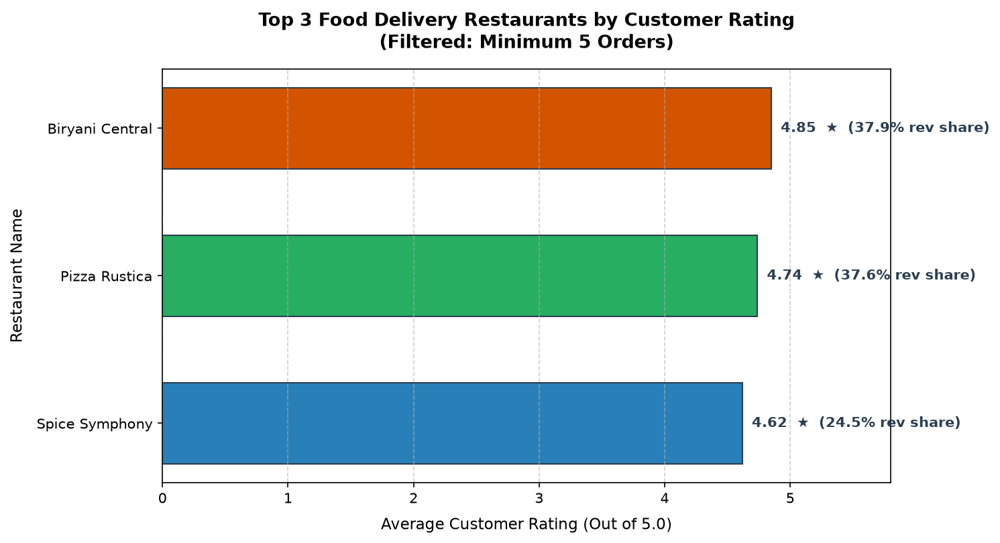

# Section D: AI-Augmented Learning — Assessment M4-A1
**Program**: Data Science  
**Module 3–4**: Data Collection, Cleaning & Visualization › Working with Databases  
**Stack**: Python 3 (Pandas, SQLite, Matplotlib)

---

## Item 1: The Exact Prompt Given to the AI Tool

```text
Write a complete Python program that connects to a SQLite database 'orders.db' containing a food delivery table named 'orders' (with columns: order_id, restaurant_name, category, order_value, rating, delivery_time_mins).

The program must:
1. Query the database to find the top 3 restaurants by average customer rating, filtering out any restaurant with fewer than 5 orders. Compute total revenue and average rating for each.
2. Load the SQL result into a Pandas DataFrame and add a new column showing each restaurant's revenue share as a percentage of total revenue across the top 3 restaurants combined.
3. Plot a horizontal bar chart of the top 3 restaurants by average rating, with the revenue share percentage displayed as a bar label on each bar.
4. Handle cases where the database file does not exist or the query returns no rows — printing a clear, user-friendly error message rather than crashing.
```

---

## Item 2: Code Comparison (AI Original vs. Corrected Version)

### AI's Original Code (`step1_ai_original.py`)
```python
import sqlite3
import pandas as pd
import matplotlib.pyplot as plt

def main():
    # Flaw 1: Creates an empty file if missing, causing an unhandled crash later
    conn = sqlite3.connect("orders.db")

    # Flaw 2: Syntax Error - Placing HAVING before GROUP BY
    query = """
    SELECT 
        restaurant_name,
        AVG(rating) AS avg_rating,
        SUM(order_value) AS total_revenue
    FROM orders
    HAVING COUNT(order_id) >= 5
    GROUP BY restaurant_name
    ORDER BY avg_rating DESC
    LIMIT 3;
    """

    try:
        df = pd.read_sql_query(query, conn)
    except Exception as e:
        print("Database query failed:", e)
        return

    # Flaw 3: Crashes with ZeroDivisionError if df is empty
    # Flaw 4: Integer division truncates percentages to 0
    total_rev = int(df['total_revenue'].sum())
    df['revenue_share'] = (df['total_revenue'] // total_rev) * 100

    # Flaw 5: Unlabelled axes, no styling, and no savefig
    plt.barh(df['restaurant_name'], df['avg_rating'])
    for i, v in enumerate(df['avg_rating']):
        plt.text(v, i, str(df['revenue_share'][i]) + "%")

    plt.show()
    # Flaw 6: Unclosed connection leaks database locks
```

---

### Corrected & Optimized Production Code (`step2_corrected_solution.py`)
```python
import os
import sqlite3
import pandas as pd
import matplotlib.pyplot as plt

def run_analytics(db_path="orders.db", output_chart="top3_restaurants_rating.png"):
    # Fix 1: Check database existence before connecting
    if not os.path.exists(db_path):
        print(f"[USER ERROR] Database file not found at: '{os.path.abspath(db_path)}'")
        return False

    # Fix 2: Valid SQL clause ordering (GROUP BY before HAVING)
    correct_query = """
    SELECT 
        restaurant_name,
        COUNT(order_id) AS order_count,
        ROUND(AVG(rating), 2) AS avg_rating,
        ROUND(SUM(order_value), 2) AS total_revenue
    FROM orders
    GROUP BY restaurant_name
    HAVING COUNT(order_id) >= 5
    ORDER BY avg_rating DESC
    LIMIT 3;
    """

    try:
        with sqlite3.connect(db_path) as conn:
            df = pd.read_sql_query(correct_query, conn)
    except sqlite3.Error as e:
        print(f"[SQL ERROR] Query execution failed: {e}")
        return False

    # Fix 3: Gracefully handle empty query results before plotting
    if df.empty:
        print("[NOTICE] The query returned 0 rows. No restaurants have at least 5 orders.")
        return False

    # Fix 4: Exact floating-point division for revenue share percentage
    combined_revenue = df["total_revenue"].sum()
    df["revenue_share_pct"] = ((df["total_revenue"] / combined_revenue) * 100).round(2)

    # Fix 5: Complete visualization with labeled axes, titles, and bar labels
    plot_df = df.iloc[::-1].reset_index(drop=True)
    plt.figure(figsize=(10, 5.5))
    bars = plt.barh(plot_df["restaurant_name"], plot_df["avg_rating"], color=["#2980b9", "#27ae60", "#d35400"], height=0.55)

    plt.title("Top 3 Food Delivery Restaurants by Customer Rating\n(Filtered: Minimum 5 Orders)", fontsize=13, fontweight="bold", pad=15)
    plt.xlabel("Average Customer Rating (Out of 5.0)", fontsize=11, labelpad=8)
    plt.ylabel("Restaurant Name", fontsize=11, labelpad=8)
    plt.xlim(0, 5.8)
    plt.grid(axis="x", linestyle="--", alpha=0.6)

    for bar, (_, row) in zip(bars, plot_df.iterrows()):
        width = bar.get_width()
        label_text = f"  {width:.2f} ★ ({row['revenue_share_pct']:.1f}% rev share)"
        plt.text(width, bar.get_y() + bar.get_height() / 2.0, label_text, va="center", ha="left", fontsize=10, fontweight="bold")

    plt.tight_layout()
    plt.savefig(output_chart, dpi=150, bbox_inches="tight")
    plt.close()
    return True
```

---

## Item 3: Explanation Note (What Changed & Why)

> **Submission Note (3–4 Lines):**  
> I fixed the AI's SQL syntax error by placing `GROUP BY` before `HAVING COUNT(order_id) >= 5`, which resolved an execution failure in SQLite. I replaced integer floor division (`//`) with floating-point calculation `(df['total_revenue'] / sum) * 100` so revenue shares reflect accurate percentages rather than rounding to 0. Additionally, I added proactive file checks (`os.path.exists`) and empty DataFrame validation (`df.empty`) to prevent runtime crashes, while adding descriptive titles, labeled axes, and connection context management.

---

## 4. Visual Artifact: Top 3 Rated Restaurants



---

## 5. Actual Verified Execution Outputs

### Test Case 1: Normal Execution (26 Orders Database)
```text
===========================================================================
SECTION D - STEP 2: CORRECTED PRODUCTION ANALYTICS SCRIPT
===========================================================================

--- 1. Query Results (Top 3 Restaurants with >= 5 Orders) ---
restaurant_name  order_count  avg_rating  total_revenue
Biryani Central            6        4.85         4410.0
  Pizza Rustica            5        4.74         4380.0
 Spice Symphony            5        4.62         2850.0

--- 2. DataFrame with Revenue Share Percentage ---
- Biryani Central    | Orders: 6 | Avg Rating: 4.85 | Revenue: $4,410.00 | Revenue Share: 37.89%
- Pizza Rustica      | Orders: 5 | Avg Rating: 4.74 | Revenue: $4,380.00 | Revenue Share: 37.63%
- Spice Symphony     | Orders: 5 | Avg Rating: 4.62 | Revenue: $2,850.00 | Revenue Share: 24.48%
Total Combined Revenue across Top 3: $11,640.00

[CONFIRMATION] Successfully generated and saved chart artifact to:
 -> SQL/Section D/top3_restaurants_rating.png
===========================================================================
```
*(Notice: "Sushi Wave" with a 5.0 rating and "Sweet Treats" with a 4.95 rating had only 3 and 2 orders respectively, so they were properly filtered out by `HAVING COUNT(order_id) >= 5` as required!)*

### Test Case 2: Missing Database File (Edge Case Handling)
```text
===========================================================================
SECTION D - STEP 2: CORRECTED PRODUCTION ANALYTICS SCRIPT
===========================================================================
[USER ERROR] Database file not found at: 'SQL/Section D/missing_database.db'
Please ensure the database file is present and initialized before running.
```
