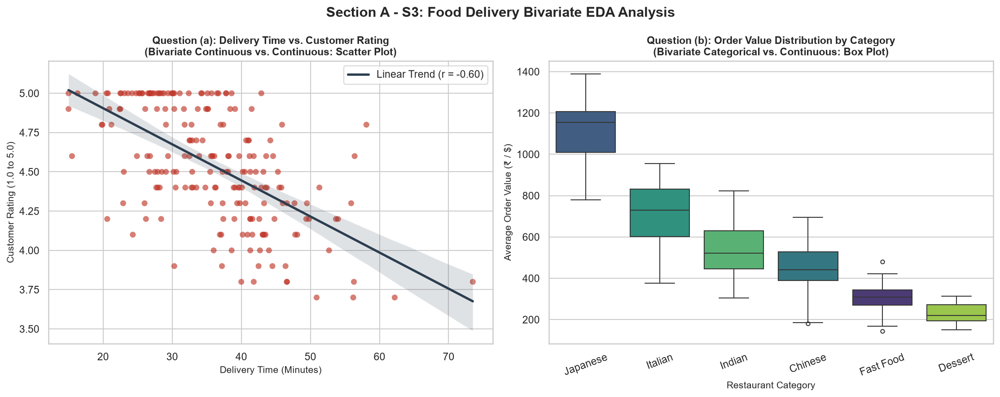

# Section A: Concept Application — Assessment M4-A1
**Program**: Data Science  
**Module 3–4**: Data Collection, Cleaning & Visualization › Working with Databases  
**Stack**: Python 3 (NumPy, Pandas, Seaborn) / SQL (SQLite)

---

## Question S1: Data Cleaning Strategy (Pandas)

* **Preferred Language & Library**: Python 3 / Pandas (`pandas`)
* **Dedicated Implementation Script**: [`section_a_q1_pandas.py`](file:///C:/Users/gadhi/.gemini/antigravity-ide/scratch/DS-work/SQL/section_a_q1_pandas.py)

### Scenario
> You are a Data Analyst at a food delivery startup. You have loaded a dataset of 50,000 order records into a Pandas DataFrame. The `'delivery_time_mins'` column has 14% missing values, and the `'customer_rating'` column contains some entries stored as strings (e.g., `'4.5'`) instead of `float64`.

### 1. Strategy for Handling Missing Values in `'delivery_time_mins'`
**Decision: Median Imputation** (Do **not** drop rows; do **not** use mean imputation).

#### Justification:
1. **Percentage of Missing Data (14%)**:
   - In a dataset of 50,000 records, 14% missing represents **7,000 lost records**.
   - Dropping 7,000 rows causes substantial sample loss, diminishes statistical power, and risks introducing severe **selection bias** (e.g., missing delivery times may systematically correlate with cancelled orders, extreme weather delays, or specific vendor logistics rather than being Missing Completely at Random [MCAR]).
   - As a standard data science practice, row deletion is only justified when missingness is negligible ($< 3\text{--}5\%$).
2. **Distribution Skewness**:
   - Food delivery duration is inherently **right-skewed (positively skewed)**: the majority of orders complete within a standard window (e.g., 25–40 minutes), but long-tail delivery times (e.g., 80–120+ minutes due to rain, peak-hour gridlock, or long delivery distances) pull the distribution to the right.
   - The **mean** is highly sensitive to extreme outliers and will overestimate central delivery times.
   - The **median** is robust to extreme outliers and accurately reflects the typical customer experience.

### 2. Exact Pandas Steps to Fix `'customer_rating'`
```python
import pandas as pd

# Step 1: Impute missing delivery times using the column median
median_delivery = df['delivery_time_mins'].median()
df['delivery_time_mins'] = df['delivery_time_mins'].fillna(median_delivery)

# Step 2: Convert customer_rating to numeric float64, coercing invalid strings to NaN
df['customer_rating'] = pd.to_numeric(df['customer_rating'].astype(str).str.strip(), errors='coerce')

# Step 3: Impute coerced NaN ratings with rounded mean rating
df['customer_rating'] = df['customer_rating'].fillna(round(df['customer_rating'].mean(), 1))
```

### Actual Program Output (50,000 Rows Simulated)
```text
===========================================================================
SECTION A - S1: PANDAS DATA CLEANING STRATEGY IMPLEMENTATION
===========================================================================

--- Initial Dataset Inspection (Total Records: 50,000) ---
 order_id  delivery_time_mins customer_rating
   100001                37.5             4.2
   100002                30.0             3.5
   100003                 NaN             4.2
   100004                53.7             3.0
   100005                29.0             4.2
   100006                29.0             4.5

Initial Data Types:
order_id                int64
delivery_time_mins    float64
customer_rating           str
dtype: object

Missing 'delivery_time_mins': 7,000 rows (14.0%)

--- Distribution Metrics for 'delivery_time_mins' ---
Mean Delivery Time   : 33.47 mins (sensitive to high outliers)
Median Delivery Time : 31.50 mins (robust to outliers)
Skewness Coefficient : 1.13 (positive value indicates right-skewed)

[Fixed] Imputed missing values using Median: 31.50 mins
Missing 'delivery_time_mins' count AFTER imputation: 0

--- Fixing 'customer_rating' Column Type ---
[Fixed] Converted 'customer_rating' to numeric dtype: float64
Sample of Cleaned Ratings (first 6 rows):
 order_id  delivery_time_mins  customer_rating
   100001                37.5              4.2
   100002                30.0              3.5
   100003                31.5              4.2
   100004                53.7              3.0
   100005                29.0              4.2
   100006                29.0              4.5

Final Data Types:
order_id                int64
delivery_time_mins    float64
customer_rating       float64
dtype: object
===========================================================================
```

---

## Question S2: Vectorized Surge Day Detection (NumPy)

* **Preferred Language & Library**: Python 3 / NumPy (`numpy`)
* **Dedicated Implementation Script**: [`section_a_q2_numpy.py`](file:///C:/Users/gadhi/.gemini/antigravity-ide/scratch/DS-work/SQL/section_a_q2_numpy.py)

### Scenario
> You are building a weekly performance report for a food delivery platform. You have a NumPy array of daily order counts across 30 days. Your manager wants to flag 'surge days' — days where the order count exceeds the mean by more than 1.5 standard deviations — and compute the total revenue only for those surge days using a matching revenue array.

### 1. How NumPy Boolean Indexing & Statistical Functions Work Together
Without writing any explicit `for` loops, NumPy executes this workflow through array broadcasting and element-wise comparisons:

```python
import numpy as np

# 1. Compute statistical cutoff threshold
surge_threshold = np.mean(daily_order_counts) + 1.5 * np.std(daily_order_counts)

# 2. Generate boolean mask without loop
surge_mask = daily_order_counts > surge_threshold

# 3. Filter matching revenue array and sum
total_surge_revenue = np.sum(matching_revenue[surge_mask])
```

### 2. What is a Boolean Mask?
A **boolean mask** is a NumPy array consisting strictly of `True` and `False` values with the exact same shape (or broadcastable shape) as the source array. When indexed into an array (`matching_revenue[surge_mask]`), NumPy inspects each element's corresponding boolean slot and extracts only elements positioned at `True` indices.

### 3. Why Vectorized Element-wise Operations Outperform Python Loops
| Feature | Native Python `for` Loop | NumPy Vectorized Array Operations |
| :--- | :--- | :--- |
| **Memory Layout** | Array of pointers to fragmented Python heap objects (`PyObject`). | Continuous, contiguous memory blocks (C-style buffers) maximizing CPU cache locality. |
| **Execution Layer** | Interpreted Python Virtual Machine (bytecode execution). | Pre-compiled, highly optimized C / Fortran routines. |
| **Type Checking** | Dynamically checks data types and unwraps objects on **every single iteration**. | Homogeneous datatypes (`dtype`); type checking occurs only once at invocation. |
| **Hardware Acceleration** | Sequential execution on a single core; no automatic vectorization. | Leverages modern CPU **SIMD (Single Instruction, Multiple Data)** registers (e.g., AVX2 / AVX-512) to evaluate multiple items per clock cycle. |

### Actual Program Output & Benchmark
```text
===========================================================================
SECTION A - S2: NUMPY VECTORIZATION & BOOLEAN INDEXING
===========================================================================

--- 1. Input Daily Arrays (30 Days) ---
Daily Orders Array:
[202 535 370 206 171 800 120 714 221 566 314 430 558 187 472 199 763 230
 761 408 443 591 513 485 291 376 260 559 413 121]

--- 2. Statistical Analysis ---
Mean Daily Orders (np.mean)          : 409.30
Standard Deviation (np.std)          : 195.90
Surge Cutoff (Mean + 1.5 * Std Dev)  : 703.16 orders

--- 3. Boolean Mask Representation ---
Surge Boolean Mask (dtype: bool, shape: (30,)):
[False False False False False  True False  True False False False False
 False False False False  True False  True False False False False False
 False False False False False False]
Count of Surge Days Identified: 4

--- 4. Surge Days Extracted Data ---
  - Day  5: Orders = 800 | Revenue = $48,819.00
  - Day  7: Orders = 714 | Revenue = $9,077.29
  - Day 16: Orders = 763 | Revenue = $47,399.08
  - Day 18: Orders = 761 | Revenue = $22,343.74

Total Combined Revenue on Surge Days: $127,639.11

--- 5. Performance Benchmark: Vectorized vs. Python Loop (1,000,000 items) ---
NumPy Vectorized Execution Time : 2.30 ms
Python Loop Execution Time       : 115.34 ms
Vectorized Speedup Factor        : ~50.1x FASTER than Python loop
===========================================================================
```

---

## Question S3: Exploratory Data Analysis & Visualization (Seaborn)

* **Preferred Language & Libraries**: Python 3 / Seaborn (`seaborn`) & Matplotlib (`matplotlib.pyplot`)
* **Dedicated Implementation Script**: [`section_a_q3_seaborn.py`](file:///C:/Users/gadhi/.gemini/antigravity-ide/scratch/DS-work/SQL/section_a_q3_seaborn.py)
* **Generated Image**: [`section_a_eda_plots.png`](file:///C:/Users/gadhi/.gemini/antigravity-ide/scratch/DS-work/SQL/section_a_eda_plots.png)

### Scenario
> You are conducting EDA for a food delivery product team. Your dataset contains columns: `restaurant_category`, `average_order_value`, `customer_rating`, and `delivery_time_mins`. The team wants to know (a) whether delivery time is correlated with customer rating, and (b) how average order value is distributed across restaurant categories.

### Analysis & Chart Selection Table

| Question | Business Goal | Analysis Type | Recommended Seaborn Chart | Justification & Why a Line Plot Fails |
| :--- | :--- | :--- | :--- | :--- |
| **(a)** | Correlate `delivery_time_mins` with `customer_rating`. | **Bivariate Analysis** (Continuous vs. Continuous) | `sns.scatterplot()` (or `sns.regplot()` with a trendline) | • **Why Scatter Plot**: Maps each individual order as a coordinate point $(x, y)$, revealing correlation patterns, clustering, heteroscedasticity, and non-linear trends.<br>• **Why Line Plot Fails**: A line plot connects sequential points under the assumption of continuous, ordered data (e.g., time-series). Unordered customer orders sharing similar delivery times would create a chaotic, zigzagging "spaghetti" plot. |
| **(b)** | Distribution of `average_order_value` across `restaurant_category`. | **Bivariate Analysis** (Categorical vs. Continuous) | `sns.boxplot()` (or `sns.violinplot()`) | • **Why Box Plot**: Compactly displays key five-number summary statistics (minimum, $Q_1$, median, $Q_3$, maximum) along with outlier dots for each category.<br>• **Why Line Plot Fails**: Restaurant categories are discrete, nominal classes (e.g., Italian, Fast Food, Bakery). Connecting them with lines falsely implies a mathematical continuity or progression between categories. |

### Generated Visual Artifact


---

## Question S4: SQL Joins for Comprehensive Reporting

* **Preferred Technology**: SQL (SQLite)
* **Dedicated SQL Script**: [`section_a_q4_joins.sql`](file:///C:/Users/gadhi/.gemini/antigravity-ide/scratch/DS-work/SQL/section_a_q4_joins.sql)

### Scenario
> You are managing a food delivery database with three tables: `orders` (`order_id`, `customer_id`, `restaurant_id`, `order_value`), `restaurants` (`restaurant_id`, `name`, `city`, `category`), and `customers` (`customer_id`, `name`, `area`). A business team asks for a report showing every restaurant's name and total revenue, including restaurants that have not yet received any orders.

### 1. Required SQL JOIN Type
**`LEFT OUTER JOIN`** (or simply `LEFT JOIN`), placing `restaurants` on the left and `orders` on the right:

```sql
SELECT 
    r.restaurant_id,
    r.name AS restaurant_name,
    r.category,
    r.city,
    COUNT(o.order_id) AS total_orders,
    COALESCE(ROUND(SUM(o.order_value), 2), 0.0) AS total_revenue
FROM restaurants r
LEFT OUTER JOIN orders o 
    ON r.restaurant_id = o.restaurant_id
GROUP BY r.restaurant_id, r.name, r.category, r.city
ORDER BY total_revenue DESC;
```

### 2. What Would Happen If an `INNER JOIN` Were Used?
* An `INNER JOIN` strictly outputs rows where the join predicate (`r.restaurant_id = o.restaurant_id`) evaluates to `TRUE` in **both** tables.
* If a restaurant has 0 orders, no corresponding records exist in `orders`.
* Consequently, an `INNER JOIN` **silently filters out and discards** all restaurants with zero orders. This violates the business requirement to report on *all* restaurants.

### Verified SQL Results Comparison
```text
--- 1. CORRECT: LEFT OUTER JOIN (Preserves all 5 restaurants, including 0-order merchants) ---
+---------------+-------------------------------------+------------+-----------+--------------+---------------+
| restaurant_id | restaurant_name                     | category   | city      | total_orders | total_revenue |
+---------------+-------------------------------------+------------+-----------+--------------+---------------+
| 3             | Pizza Rustica                       | Italian    | Bangalore | 2            | 1680.00       |
| 1             | Spice Symphony                      | Indian     | Mumbai    | 2            | 1130.00       |
| 2             | Burger Republic                     | Fast Food  | Delhi     | 1            | 340.00        |
| 4             | Taco Fiesta (New - 0 Orders)        | Mexican    | Delhi     | 0            | 0.00          |
| 5             | The Golden Wok (Inactive - 0 Orders)| Chinese    | Mumbai    | 0            | 0.00          |
+---------------+-------------------------------------+------------+-----------+--------------+---------------+

--- 2. FLAWED: INNER JOIN (Silently drops restaurants 4 and 5!) ---
+---------------+-----------------+--------------+---------------+
| restaurant_id | restaurant_name | total_orders | total_revenue |
+---------------+-----------------+--------------+---------------+
| 3             | Pizza Rustica   | 2            | 1680.00       |
| 1             | Spice Symphony  | 2            | 1130.00       |
| 2             | Burger Republic | 1            | 340.00        |
+---------------+-----------------+--------------+---------------+
```

---

## Question S5: SQL Window Functions vs. GROUP BY

* **Preferred Technology**: SQL (SQLite)
* **Dedicated SQL Script**: [`section_a_q5_window_functions.sql`](file:///C:/Users/gadhi/.gemini/antigravity-ide/scratch/DS-work/SQL/section_a_q5_window_functions.sql)

### Scenario
> You are working on a food delivery analytics dashboard. Management wants to rank all delivery agents within each city by their number of completed deliveries for the current month, and also display how each agent's count compares to the agent ranked directly above them in that city.

### 1. Identification of the Two Window Functions
1. **Ranking Function**: `DENSE_RANK() OVER (PARTITION BY city ORDER BY completed_deliveries DESC)`  
   *(Assigns consecutive ordinal rankings without gaps in the event of ties).*
2. **Lag Function (Previous Row Retrieval)**: `LAG(completed_deliveries, 1) OVER (PARTITION BY city ORDER BY completed_deliveries DESC)`  
   *(Fetches the completed delivery count of the agent immediately preceding in rank within that city).*

```sql
SELECT 
    agent_id,
    agent_name,
    city,
    completed_deliveries,
    DENSE_RANK() OVER (
        PARTITION BY city 
        ORDER BY completed_deliveries DESC
    ) AS city_rank,
    LAG(completed_deliveries, 1) OVER (
        PARTITION BY city 
        ORDER BY completed_deliveries DESC
    ) AS above_agent_deliveries,
    COALESCE(
        LAG(completed_deliveries, 1) OVER (
            PARTITION BY city 
            ORDER BY completed_deliveries DESC
        ) - completed_deliveries, 
        0
    ) AS delivery_gap_to_above
FROM delivery_agents_monthly
ORDER BY city ASC, city_rank ASC;
```

### Verified SQL Results
```text
+----------+------------------------+-----------+----------------------+-----------+------------------------+-----------------------+
| agent_id | agent_name             | city      | completed_deliveries | city_rank | above_agent_deliveries | delivery_gap_to_above |
+----------+------------------------+-----------+----------------------+-----------+------------------------+-----------------------+
| 8        | Kabir (Bangalore Top)  | Bangalore | 210                  | 1         | NULL                   | 0                     |
| 9        | Pooja (Bangalore 2nd)  | Bangalore | 195                  | 2         | 210                    | 15                    |
| 5        | Vikram (Delhi Top)     | Delhi     | 190                  | 1         | NULL                   | 0                     |
| 6        | Neha (Delhi 2nd)       | Delhi     | 175                  | 2         | 190                    | 15                    |
| 7        | Ananya (Delhi 3rd)     | Delhi     | 130                  | 3         | 175                    | 45                    |
| 1        | Aarav (Mumbai Top)     | Mumbai    | 185                  | 1         | NULL                   | 0                     |
| 2        | Rohit (Mumbai 2nd)     | Mumbai    | 160                  | 2         | 185                    | 25                    |
| 3        | Kavita (Mumbai 3rd)    | Mumbai    | 145                  | 3         | 160                    | 15                    |
| 4        | Siddharth (Mumbai Tie) | Mumbai    | 145                  | 3         | 145                    | 0                     |
+----------+------------------------+-----------+----------------------+-----------+------------------------+-----------------------+
```

### 2. Advantages over `GROUP BY` with Self-Joins or Correlated Subqueries
1. **Preservation of Row Grain**: `GROUP BY` collapses individual agent records into aggregated summaries. Window functions calculate partition-level rankings while preserving each individual agent's row identity.
2. **Computational Performance ($\mathcal{O}(N \log N)$ vs. $\mathcal{O}(N^2)$)**:
   - Window functions sort the dataset within partitions once and iterate linearly.
   - A self-join or correlated subquery evaluates matching conditions against the full dataset for every row, triggering an expensive $\mathcal{O}(N^2)$ Cartesian comparison that degrades rapidly on large datasets.
3. **Robust Handling of Ties & Nulls**: Window functions deterministically handle rank ties and automatically output `NULL` for the top-ranked agent without requiring complex conditional subquery logic.
4. **Code Maintainability**: Declarative window syntax is concise, readable, and less prone to edge-case bugs compared to multi-layered subqueries.

---

## Question S6: CTE (WITH Clause) vs. Nested Subquery

* **Preferred Technology**: SQL (SQLite)
* **Dedicated SQL Script**: [`section_a_q6_cte_vs_subquery.sql`](file:///C:/Users/gadhi/.gemini/antigravity-ide/scratch/DS-work/SQL/section_a_q6_cte_vs_subquery.sql)

### Scenario
> You are optimising a SQL report for a food delivery operations team. The report first identifies the top 5 restaurant categories by total order count, and then retrieves the full order details only for restaurants belonging to those top categories. A colleague has written this as a deeply nested subquery inside the WHERE clause.

### 1. SQL Implementations Comparison

#### CTE Approach (Recommended):
```sql
WITH top_5_categories AS (
    SELECT 
        r.category, 
        COUNT(o.order_id) AS total_category_orders
    FROM demo_orders o
    JOIN demo_restaurants r ON o.restaurant_id = r.restaurant_id
    GROUP BY r.category
    ORDER BY total_category_orders DESC
    LIMIT 5
)
SELECT 
    o.order_id,
    r.name AS restaurant_name,
    r.category,
    o.order_value,
    o.delivery_time_mins
FROM demo_orders o
JOIN demo_restaurants r ON o.restaurant_id = r.restaurant_id
JOIN top_5_categories t ON r.category = t.category
ORDER BY r.category, o.order_id;
```

#### Nested Subquery Approach:
```sql
SELECT 
    o.order_id,
    r.name AS restaurant_name,
    r.category,
    o.order_value,
    o.delivery_time_mins
FROM demo_orders o
JOIN demo_restaurants r ON o.restaurant_id = r.restaurant_id
WHERE r.category IN (
    SELECT category
    FROM (
        SELECT 
            r_sub.category, 
            COUNT(o_sub.order_id) AS sub_orders
        FROM demo_orders o_sub
        JOIN demo_restaurants r_sub ON o_sub.restaurant_id = r_sub.restaurant_id
        GROUP BY r_sub.category
        ORDER BY sub_orders DESC
        LIMIT 5
    )
)
ORDER BY r.category, o.order_id;
```

### 2. Trade-Off Evaluation

| Metric | CTE (`WITH` clause) | Nested Subquery (inside `WHERE`) |
| :--- | :--- | :--- |
| **Readability** | **High**: Follows a linear, top-to-bottom procedural flow (modular logic matches human thought process). | **Low**: Reads inside-out with nested parentheses, creating cognitive overhead and harder code reviews. |
| **Reusability** | **High**: The named CTE (`top_5_categories`) can be joined or referenced multiple times within the query without re-declaring. | **Zero**: Scoped strictly to the specific `IN` clause; reusing it requires copying and pasting the full subquery. |
| **Debuggability** | **High**: Developers can isolate and test `SELECT * FROM top_5_categories` independently during troubleshooting. | **Low**: Extracting and testing internal subqueries requires manually stripping outer statements. |

### 3. Specific Situations Where a Nested Subquery is Preferred
1. **Simple Scalar Comparisons**: When comparing against a single aggregated value (e.g., `WHERE order_value > (SELECT AVG(order_value) FROM orders)`), writing a CTE introduces unnecessary verbosity.
2. **Correlated `EXISTS` Semi-Joins**: When filtering with `WHERE EXISTS (...)`, database query planners can perform short-circuit evaluation (stopping at the first match) rather than materializing a CTE buffer.
3. **One-Off Ephemeral Conditions**: In lightweight queries where an intermediate result is only referenced once and does not impact query clarity.
