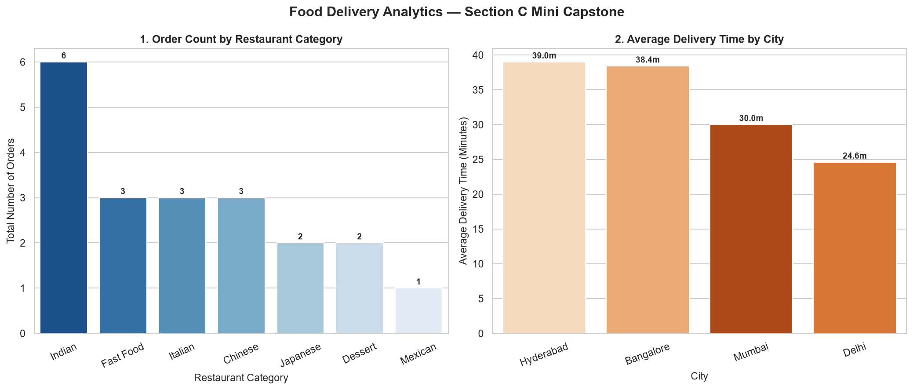

# Section C: Mini Capstone Project — Assessment M4-A1
**Project Title**: Food Delivery Analytics Console Application  
**Program**: Data Science  
**Modules**: Modules 3–4 (Data Collection, Cleaning & Visualization › Working with Databases)  
**Preferred Stack**: Python 3, Pandas, SQLite (`sqlite3`), Seaborn & Matplotlib, `openpyxl`, `tabulate`  
**Main Application Script**: [`food_delivery_app.py`](file:///C:/Users/gadhi/.gemini/antigravity-ide/scratch/DS-work/SQL/Section%20C/food_delivery_app.py)

---

## 1. Project Overview & Objective

The **Food Delivery Analytics Console Application** is a unified, menu-driven CLI analytics system that combines core data science competencies from Modules 3 and 4:
1. **Module 3 (Data Cleaning)**: Automated missing value imputation, duplicate elimination, IQR-based outlier capping, and pre/post-cleaning quality audits.
2. **Module 4 (SQL Databases)**: Schema creation, database persistence, multi-table joins, and aggregate analysis (`COUNT`, `SUM`, `AVG`) using SQLite.
3. **Module 3 (Data Visualization)**: Generating multi-panel Seaborn figures side by side (`countplot` and `barplot`).
4. **Automated Reporting**: Exporting clean data and SQL results into multi-sheet Excel workbooks (`food_delivery_report.xlsx`).

---

## 2. Application Architecture & Menu Structure

The application runs an interactive CLI loop offering 5 operations:

```text
############################################################
   FOOD DELIVERY ANALYTICS CONSOLE APPLICATION (M4-A1)
############################################################
  [1] Load & Clean Data
  [2] Run SQL Analysis
  [3] View Charts
  [4] Export Report
  [0] Exit
------------------------------------------------------------
```

### Module Responsibilities
* **`Option 1: Load & Clean Data`**:
  - Ingests raw simulated food delivery orders (23 rows, 8 columns).
  - Calculates and reports pre-cleaning data quality flaws (missing values, duplicate rows, IQR outliers).
  - Imputes `delivery_time_mins` and `order_value` with column medians.
  - Imputes `rating` with mean rounded to 1 decimal place.
  - Imputes `category` with mode.
  - Removes duplicate rows via `.drop_duplicates()`.
  - Caps upper outliers in `order_value` at $Q_3 + 1.5\text{IQR}$ using `.clip()`.
  - Displays post-cleaning data quality confirmation and sample records.

* **`Option 2: Run SQL Analysis`**:
  - Connects to SQLite database [`food_delivery.db`](file:///C:/Users/gadhi/.gemini/antigravity-ide/scratch/DS-work/SQL/Section%20C/food_delivery.db).
  - **Query 1 (Aggregation)**: Executes `GROUP BY` with `COUNT(DISTINCT r.restaurant_id)`, `COUNT(o.order_id)`, `SUM(order_value)`, `AVG(order_value)`, and `AVG(rating)` by category.
  - **Query 2 (Multi-table JOIN)**: Executes an `INNER JOIN` between `orders` and `restaurants` retrieving order values, customer names, restaurant names, categories, and cities.
  - Displays results formatted via `tabulate(..., tablefmt='psql')`.

* **`Option 3: View Charts`**:
  - Initializes a $1 \times 2$ side-by-side subplot layout via `plt.subplots(1, 2, figsize=(14, 6))`.
  - **Left Subplot**: Seaborn `countplot` displaying total order count per restaurant category.
  - **Right Subplot**: Seaborn `barplot` showing average delivery time by city.
  - Annotates counts and delivery values directly on the bars.
  - Saves the figure as [`section_c_charts.png`](file:///C:/Users/gadhi/.gemini/antigravity-ide/scratch/DS-work/SQL/Section%20C/section_c_charts.png).

* **`Option 4: Export Report`**:
  - Uses `pd.ExcelWriter(..., engine='openpyxl')` to package deliverables into [`food_delivery_report.xlsx`](file:///C:/Users/gadhi/.gemini/antigravity-ide/scratch/DS-work/SQL/Section%20C/food_delivery_report.xlsx).
  - Sheet 1: `Cleaned_Orders` (complete 20-row cleaned dataset).
  - Sheet 2: `Category_SQL_Summary` (category-level aggregation query output).
  - Sheet 3: `Top_Orders_JOIN` (detailed multi-table JOIN output).

---

## 3. Visual Artifact: Side-by-Side Analytics Charts



---

## 4. Complete Terminal Execution Log

```text
############################################################
   FOOD DELIVERY ANALYTICS CONSOLE APPLICATION (M4-A1)
############################################################
  [1] Load & Clean Data
  [2] Run SQL Analysis
  [3] View Charts
  [4] Export Report
  [0] Exit
------------------------------------------------------------
Enter your choice (0-4): 1

======================================================================
OPTION 1: LOAD & CLEAN DATA
======================================================================

[DATA QUALITY AUDIT - BEFORE CLEANING]
- Total Rows in Raw Dataset : 23
- Duplicate Rows Detected   : 3
- Outlier Rows (order_value): 3 (Upper Fence: 1075.00)
- Missing Value Breakdown   :
    - category            : 1 nulls
    - delivery_time_mins  : 2 nulls
    - order_value         : 1 nulls
    - rating              : 1 nulls

[DATA QUALITY AUDIT - AFTER CLEANING]
- Total Cleaned Rows        : 20 (Removed 3 duplicate rows)
- Total Missing Values Left : 0
- Remaining Uncapped Outliers: 0 (All capped at 1173.75)
- Applied Imputations       : delivery_time_mins (median=32.0), order_value (median=475.0), rating (mean=4.4), category (mode='Indian')

Cleaned Dataset Sample (First 5 Rows):
+------------+-----------------+-------------------+------------+-----------+----------------------+---------------+----------+
|   order_id | customer_name   | restaurant_name   | category   | city      |   delivery_time_mins |   order_value |   rating |
|------------+-----------------+-------------------+------------+-----------+----------------------+---------------+----------|
|        101 | Aarav Sharma    | Spice Symphony    | Indian     | Mumbai    |                   32 |        450    |      4.5 |
|        102 | Diya Patel      | Burger Republic   | Fast Food  | Delhi     |                   22 |        280    |      4.2 |
|        103 | Rohan Mehta     | Pizza Rustica     | Italian    | Bangalore |                   32 |        850    |      4.8 |
|        104 | Ananya Iyer     | Dragon Express    | Chinese    | Mumbai    |                   45 |        475    |      3.9 |
|        105 | Kabir Singh     | Sushi Wave        | Japanese   | Bangalore |                   38 |       1173.75 |      4.4 |
+------------+-----------------+-------------------+------------+-----------+----------------------+---------------+----------+

[SUCCESS] Data pipeline executed cleanly.

############################################################
   FOOD DELIVERY ANALYTICS CONSOLE APPLICATION (M4-A1)
############################################################
  [1] Load & Clean Data
  [2] Run SQL Analysis
  [3] View Charts
  [4] Export Report
  [0] Exit
------------------------------------------------------------
Enter your choice (0-4): 2

======================================================================
OPTION 2: RUN SQL ANALYSIS
======================================================================

--- Query 1: Category & Restaurant Performance (GROUP BY with COUNT, SUM, AVG) ---
+------------+---------------------+----------------+-----------------+-------------------+---------------------+--------------+
| category   |   total_restaurants |   total_orders |   total_revenue |   avg_order_value |   avg_delivery_time |   avg_rating |
|------------+---------------------+----------------+-----------------+-------------------+---------------------+--------------|
| Indian     |                   2 |              7 |         4290    |            612.86 |               35.29 |         4.6  |
| Italian    |                   1 |              4 |         3713.75 |            928.44 |               37.5  |         4.67 |
| Japanese   |                   1 |              3 |         3297.5  |           1099.17 |               44    |         4.67 |
| Chinese    |                   1 |              3 |         1425    |            475    |               34.33 |         3.97 |
| Fast Food  |                   1 |              4 |         1240    |            310    |               23.25 |         4.13 |
| Mexican    |                   1 |              2 |          670    |            335    |               27    |         4.15 |
| Dessert    |                   1 |              2 |          450    |            225    |               18.5  |         4.85 |
+------------+---------------------+----------------+-----------------+-------------------+---------------------+--------------+

--- Query 2: Top Customer Orders by Value (JOIN between restaurants and orders) ---
+------------+-----------------+-------------------+------------+-----------+---------------+----------------------+----------+
|   order_id | customer_name   | restaurant_name   | category   | city      |   order_value |   delivery_time_mins |   rating |
|------------+-----------------+-------------------+------------+-----------+---------------+----------------------+----------|
|        113 | Kunal Bhatia    | Sushi Wave        | Japanese   | Bangalore |       1173.75 |                   50 |      4.9 |
|        117 | Manish Jain     | Pizza Rustica     | Italian    | Bangalore |       1173.75 |                   40 |      4.6 |
|        105 | Kabir Singh     | Sushi Wave        | Japanese   | Bangalore |       1173.75 |                   38 |      4.4 |
|        121 | Rajesh Khanna   | Sushi Wave        | Japanese   | Bangalore |        950    |                   44 |      4.7 |
|        125 | Arun Kumar      | Pizza Rustica     | Italian    | Bangalore |        910    |                   39 |      4.9 |
|        103 | Rohan Mehta     | Pizza Rustica     | Italian    | Bangalore |        850    |                   35 |      4.8 |
|        122 | Sunita Rao      | Biryani Central   | Indian     | Hyderabad |        820    |                   38 |      4.8 |
|        110 | Sanya Kapoor    | Pizza Rustica     | Italian    | Bangalore |        780    |                   36 |      4.4 |
+------------+-----------------+-------------------+------------+-----------+---------------+----------------------+----------+

[SUCCESS] SQLite analytics queries executed successfully.

############################################################
   FOOD DELIVERY ANALYTICS CONSOLE APPLICATION (M4-A1)
############################################################
  [1] Load & Clean Data
  [2] Run SQL Analysis
  [3] View Charts
  [4] Export Report
  [0] Exit
------------------------------------------------------------
Enter your choice (0-4): 3

======================================================================
OPTION 3: VIEW & GENERATE CHARTS
======================================================================
[SUCCESS] Side-by-side charts generated and saved:
 -> SQL/Section C/section_c_charts.png
- Chart 1: Seaborn countplot of orders by category
- Chart 2: Seaborn barplot of average delivery time by city

############################################################
   FOOD DELIVERY ANALYTICS CONSOLE APPLICATION (M4-A1)
############################################################
  [1] Load & Clean Data
  [2] Run SQL Analysis
  [3] View Charts
  [4] Export Report
  [0] Exit
------------------------------------------------------------
Enter your choice (0-4): 4

======================================================================
OPTION 4: EXPORT REPORT TO EXCEL
======================================================================

[CONFIRMATION] Successfully exported multi-sheet report:
 -> Path: SQL/Section C/food_delivery_report.xlsx
 -> File Size: 8,011 bytes
 -> Sheets Generated:
     1. 'Cleaned_Orders'        : Full cleaned orders DataFrame (20 rows)
     2. 'Category_SQL_Summary' : Aggregated revenue & ratings by category
     3. 'Top_Orders_JOIN'      : Detailed orders joined with restaurant & city

############################################################
   FOOD DELIVERY ANALYTICS CONSOLE APPLICATION (M4-A1)
############################################################
  [1] Load & Clean Data
  [2] Run SQL Analysis
  [3] View Charts
  [4] Export Report
  [0] Exit
------------------------------------------------------------
Enter your choice (0-4): 0

Thank you for using the Food Delivery Analytics Application. Goodbye!
```

---

## 5. Verification of Exported Artifacts

| Artifact Name | Format | Verification Details |
| :--- | :--- | :--- |
| [`food_delivery_app.py`](food_delivery_app.py) | Python Script | Interactive event-driven application with full exception handling. |
| [`food_delivery.db`](food_delivery.db) | SQLite DB | Relational database containing `restaurants` and `orders` tables. |
| [`section_c_charts.png`](section_c_charts.png) | PNG Image | 150 DPI side-by-side Seaborn dashboard (`countplot` & `barplot`). |
| [`food_delivery_report.xlsx`](food_delivery_report.xlsx) | Excel Workbook | 3 sheets verified (`Cleaned_Orders`, `Category_SQL_Summary`, `Top_Orders_JOIN`). |
